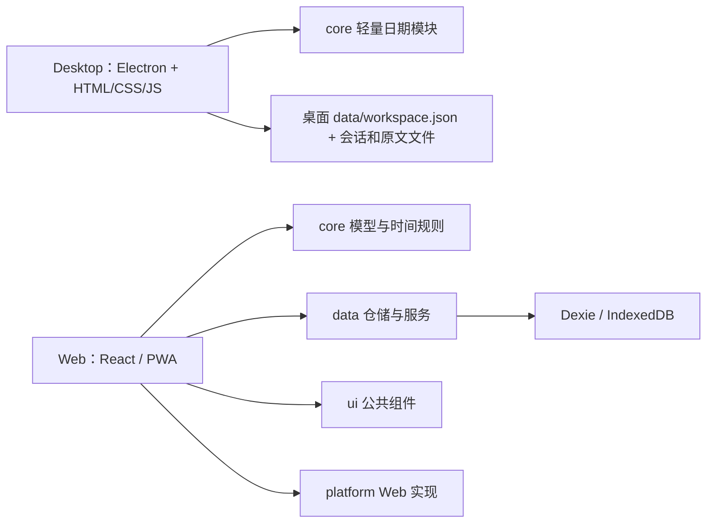

# 几微 · JeeWeave

作者：**[ArrSk](https://github.com/ArrSk)**。

本地优先的课程表与个人工作台，提供 **Web/PWA**、**Windows Desktop** 和复用桌面业务的 **Android Beta**。课程、计划和待办默认保存在本机；教务导入与网页采集按需访问对应网站。

设计正在向“围绕一件事组织日常”演进。Desktop 本地开发版的对象视图 Beta 可按课程/项目/主题关联排课、事项、笔记及网页原文，返回原功能编辑；普通事项支持多段执行安排。今天主页集中显示明确包含今天的日程，其他待处理事项放入可折叠的独立弹窗。这些功能已纳入 Windows 0.3.0 交付。先读[对象与事情设计](docs/product/对象与事情设计.md)，全部说明按对象和用途见[文档导航](docs/README.md)。

[Web 在线入口](https://arrsk.github.io/JeeWeave/) · [Web 文档](web/README.md) · [Desktop 技术框架](desktop/README.md) · [目录与文件说明](docs/开发目录说明.md) · [两端功能对照](docs/development/桌面与网页版功能对照.md)

2026-10-24 本地源码新增：事项目标与完成标准、具体课次布置来源、阶段/重复事项的独立执行安排、跨模块查找；两端按 DeepSeek 观察报告优化导航与弹层，Web 适配手机宽度。以上尚未发布，现有 0.3.0 下载不含这些改动；体验与边界见 [HANDOVER](docs/HANDOVER.md)。

项目处于持续开发阶段。英文名称现为 **JeeWeave**；GitHub 仓库统一为 **ArrSk/JeeWeave**，Pages 使用 **/JeeWeave/** 路径。本次 Windows Desktop 交付版本为 **0.3.0**，Web 保留独立的浏览器/PWA 体验。[GitHub Release](https://github.com/ArrSk/JeeWeave/releases/tag/v0.3.0) · [Windows x64 ZIP](https://github.com/ArrSk/JeeWeave/releases/download/v0.3.0/jeeweave-0.3.0-Windows-x64.zip) · [SHA-256](https://github.com/ArrSk/JeeWeave/releases/download/v0.3.0/jeeweave-0.3.0-Windows-x64.zip.sha256)。完整解压后双击“几微.exe”，保留同目录运行资源。源码通过 Git 提交，成品通过 Release 分发；两者均不包含个人资料或登录状态。

## 分支与共用代码

| 分支 | 用途 |
| --- | --- |
| [main](https://github.com/ArrSk/JeeWeave/tree/main) | 共用代码与经过验收的集成基线 |
| [web](https://github.com/ArrSk/JeeWeave/tree/web) | 网页/PWA，主要维护web目录 |
| [pc](https://github.com/ArrSk/JeeWeave/tree/pc) | Windows桌面，主要维护desktop目录 |
| [mobile](https://github.com/ArrSk/JeeWeave/tree/mobile) | Android，主要维护mobile目录 |

共用改动在main提交一次，端分支通过merge引用原提交，不复制文件或反复cherry-pick。各分支保留完整源码树，保证桌面/手机共用业务及工作区构建依赖可用。初次分支建立共享同一提交，后续按端独立演进。开发步骤见[三端分支协作](docs/development/分支协作.md)。

## 两个客户端

| 能力 | Web / PWA | Windows Desktop |
| --- | --- | --- |
| 多课表、周/日视图、课程增删改 | 已实现 | 已实现；七色选项、逐周编辑、课程信息完整换行 |
| 周次、单双周、连堂、逐学期作息 | 已实现 | 已实现 |
| 阅读字号与课表密度 | 标准/大字、紧凑/宽松 | 已移植，偏好随 data 保存 |
| 批量课程编辑 | 名称、星期、节次、周次 | 名称、教师、地点、星期、节次、周次 |
| 批量作息与外观 | 作息重排及外观设置 | 分时段批量作息、9 套主题与自定义背景/文字 |
| 单次调课、停课与恢复 | 已实现 | 已实现；课表/今天/日历及 ICS 同源 |
| 今天、计划、待办、示例导入 | 已实现 | 统一为“事项”入口和编辑器；含事件/考试、阶段，示例仅在开发者模式显示 |
| 待办与计划日历 | 未实现 | 默认月视图，可切周/日；事件/考试按时段定位，具体截止显示为时间点 |
| 课程文件导入/导出 | CSV / ICS，先预览确认 | CSV / ICS，可编辑预览、重复跳过/冲突提醒 |
| JSON 数据备份 | 导出及恢复 | 版本化导出、确认恢复及旧桌面快照兼容；开发者可备份后清空全部本地数据并重启 |
| 南邮 WebVPN 实时课表导入 | 未接入 | 手动登录后导入；保留合并节次、单双周与待安排记录 |
| 公开静态网页整理 | 未接入 | 原文、重点、可编辑行动草稿，确认后加入待办 |
| 对象视图 Beta | 未实现 | 课程/项目/主题集中展示排课、事项/阶段、笔记和网页资料，支持双向跳转 |
| 笔记 | 未实现 | 0.3.0：可选用途、草稿、时间轴、搜索、归档与导出；对象归属、选文确认提炼事项及双向来源跳转 |
| 内置功能开关 | 已实现 | 本地源码插件管理内 10 项开关；计划/待办合并为事项，含对象视图与笔记，关闭保留资料 |
| 内置插件底座 | Web 独立维护 | 0.3.0：现有业务统一服务、引用路由、命名空间及启停生命周期 |
| QQ / 微信群消息整理 | 未实现 | 开发暂停；界面及接收已停用，原代码和历史资料保留 |
| 运行方式 | 浏览器 / PWA | Electron 免安装文件夹 |

本地桌面源码已加入可开关的全局AI助手和定时/静默/长期提醒；此前已发布的0.3.0包不包含它们。记账、完整知识库、第三方插件运行时、跨端同步及原生锁屏闹钟尚未实现。客户端分别保存，不会自动同步。

2026-10-25 新增 [Android Beta](mobile/README.md)：复用桌面端内置业务，轻顶栏、侧滑目录与触屏编辑；离线 APK 面向 Android 8.0 以上、WebView 108 以上设备，不需要 Google 服务。支持课程、事项、日历、笔记、对象和手动工作区迁移。手机教务登录/抓取已本地实现，公开网页在线抓取仍待移植，真机待验；纯鸿蒙 NEXT 不支持 APK。本地包位于 mobile/release，尚未上传 GitHub。

2026-10-21 本地开发版已加入[笔记首版](docs/product/随记功能与开发流程.md)，支持无标题记录、即时草稿、按日回看、标签/日期搜索、归档/回收站及 Markdown 导出；随同一 data 备份和迁移。新增[内置业务宿主](docs/design/插件化底座与迁移流程.md)，统一服务、命令、导航与资源清理，笔记通过它接入。10 月 22 日本地版已接通笔记对象归属、选文确认提炼事项、普通事项多段执行安排及今天/日历投影，完整第三方插件运行时尚未实现。以上改动已纳入 0.3.0；使用 Release ZIP 或 desktop/debug.cmd 体验。[路线图](docs/ROADMAP.md)与[案例调研](docs/research/随记与插件架构案例.md)区分当前实现和后续目标。

## 界面


*使用虚构测试数据，截图为此前的课程表界面。桌面侧栏按内置功能开关显示；记账和外部 AI 尚未实现。Web 窄屏示例见 [Web README](web/README.md)。*

## 技术与代码边界

| 部分 | 当前技术 | 数据存储 |
| --- | --- | --- |
| Desktop | Electron 44、Node.js、原生 HTML/CSS、JavaScript ES Modules、受限 IPC、electron-builder | 版本化 workspace.json；业务、会话、原文和设置集中在 data |
| Android Beta | Java Activity + 系统 WebView，复用 Desktop 的 HTML/CSS/ES Modules 与可信插件；官方 SDK CLI 构建 APK | 应用私有 files/data/workspace.json，AtomicFile、上一版与导入前备份；系统文件选择导入/导出 |
| Web | React 19、TypeScript 5.9、Vite 7、Tailwind CSS 4、Zustand 5、vite-plugin-pwa | IndexedDB / Dexie 4，经公共仓储访问 |
| Core | Zod 4、日期/教学周/课次规则 | 纯逻辑；桌面当前只直接复用轻量日期模块 |
| 验证 | Vitest、Node 内置测试、真实 Electron 隔离交互、生产产物检查 | 测试使用虚构数据和独立会话 |



桌面和网页有各自的界面与启动入口。公共层的统一模型、UI 和仓储目前主要服务 Web；桌面尚未完成统一仓储迁移。桌面进程划分、教务浏览/抓取与安全设置详见 [Desktop README](desktop/README.md)。

## 仓库结构

```text
JeeWeave/（本地项目目录与 GitHub 仓库同名）
├─ desktop/                 桌面源码、调试/封装入口与回归测试
│  ├─ README.md             Desktop 技术框架与数据说明
│  └─ tests/                教务模拟、交互、成品启动检查
├─ web/                     独立 React / PWA 客户端
│  ├─ README.md             Web 架构、开发和部署说明
│  ├─ src/                  页面、设置、状态与样式
│  └─ tests/                隔离浏览器交互检查
├─ shared/packages/         core、data、ui、platform
├─ scripts/                 构建、预览与维护工具
├─ docs/                    使用说明、技术记录和虚构数据截图
├─ .github/workflows/       Web 检查与 Pages 部署
├─ package.json             工作区命令及桌面封装配置
├─ pnpm-workspace.yaml      工作区与安装设置
└─ pnpm-lock.yaml           锁定依赖版本
```

`node_modules`、`dist`、`desktop/release`、本地缓存、备份与个人资料由忽略规则排除，不作为源码提交。Windows 成品将来发布时使用独立分发包，不携带自己的 data。

## 开发运行

准备 Node.js **22.12+**（本机验证使用 Node 24）和 `package.json` 指定的 **pnpm 11.25.0**。以下命令在仓库根目录执行：

```sh
pnpm install --frozen-lockfile
```

| 目标 | 命令 |
| --- | --- |
| Web 开发，默认端口 5273 | `pnpm dev` |
| Web 生产构建 / 预览 | `pnpm build` / `pnpm preview` |
| 下载/检查 Electron 运行时，首次需要网络 | `pnpm exec install-electron` |
| Desktop 开发启动 | `pnpm desktop:run` |
| Windows x64 免安装封装 | `pnpm desktop:package`，先确保 Electron 运行时就绪 |

Windows 可使用 `desktop/debug.cmd` 启动桌面端，在“设置 → 开发者模式”显示示例入口与抓取原文；`web/启动开发服务器.cmd` 启动网页开发。最终桌面包自带运行时，使用者无需安装开发工具。

Electron 二进制下载与镜像设置见[官方安装说明](https://www.electronjs.org/docs/latest/tutorial/installation)。封装输出在 `desktop/release/`；当前封装及原路径启动验证依赖 Windows/PowerShell。

## 检查

```sh
pnpm typecheck
pnpm test
pnpm desktop:test
pnpm build
pnpm smoke
pnpm check:repo
```

需要交互验证时，构建 Web 并准备 Electron 运行时后运行 `pnpm web:test:ui`；桌面交互、教务读取与成品检查命令见 [Desktop README](desktop/README.md#验证)。Windows 另可用 `pwsh -NoProfile -File scripts/verify.ps1` 完成类型检查、Web/公共层单测、生产构建与 smoke；桌面测试仍需另行执行。

类型检查、单测、产物和分项交互的最新实际范围见 [HANDOVER](docs/HANDOVER.md)，不代表未测试设备或所有学校都已支持。

## 数据与当前限制

Web 资料保存在浏览器当前来源的 IndexedDB；桌面开发数据在 desktop/data，成品数据在 exe 同级 data。0.3.0 可在设置中导出单个迁移包，或选择旧数据文件夹/JSON，预览兼容情况后备份并导入；公开 0.2.1 仍使用整目录复制。步骤与边界见 [桌面数据说明](desktop/DATA_FORMAT.md)。Web 和桌面 JSON 使用独立契约，不能互相恢复。

教务认证由用户在学校页面手动完成，当前适配以南邮 WebVPN 实测为准。公开网页采集只处理静态文本，使用本地规则生成草稿，不调用外部 AI。Windows 成品尚未可信签名，可能显示应用信誉警告；macOS/Linux 成品、自动更新及手机真机覆盖仍待后续工作。

## 文档与协作

- [Web README](web/README.md) / [Desktop README](desktop/README.md)：各端当前框架、运行方法和边界。
- [GitHub 提交审查稿](docs/development/GITHUB_REVIEW.md)：本次整理范围、源码边界及待审查事项。
- [文档导航](docs/README.md) / [逐文件用途索引](docs/文件用途索引.md)：查找说明与代码入口。
- [使用说明](docs/guides/使用说明.md) / [交接记录](docs/HANDOVER.md)：操作方法与实际验证记录。
- [架构与长期设计](docs/ARCHITECTURE.md) / [决策](docs/DECISIONS.md) / [路线图](docs/ROADMAP.md)：其中的未来方案不等于当前能力。

维护规则见 [AGENTS.md](AGENTS.md)。修改后执行对应检查，使用虚构样本，不提交账号、Cookie、个人 profile 或真实课表。`pnpm save` 会提交并推送，不作为日常验证命令使用。

## 许可

[MIT](LICENSE)。Electron 等依赖按各自许可证分发，Windows 包保留随运行时附带的许可文件。
