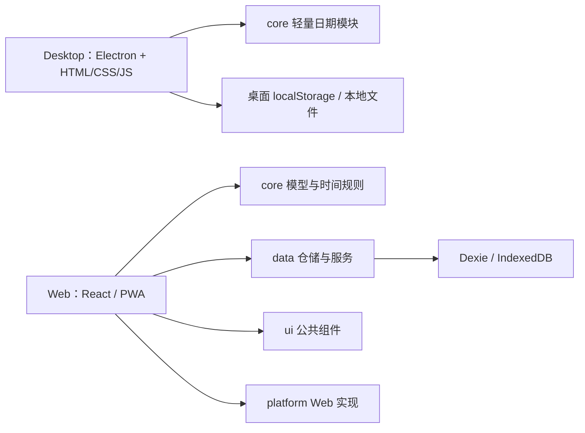

# 几微 · jiwei

本地优先的课程表与个人工作台，提供 **Web/PWA** 和 **Windows Desktop** 两个独立客户端。课程、计划和待办默认保存在本机；教务导入与网页采集按需访问对应网站。

[Web 在线入口](https://arrsk.github.io/jiwei/) · [Web 文档](web/README.md) · [Desktop 技术框架](desktop/README.md) · [目录与文件说明](docs/开发目录说明.md)

项目处于持续开发阶段。Windows x64 免安装版已完成本机启动及用户体验验收；Web 保留独立的浏览器/PWA 体验。当前没有公开发布的安装包下载入口，源码仓库不包含本机 exe、课表资料或登录状态。

## 两个客户端

| 能力 | Web / PWA | Windows Desktop |
| --- | --- | --- |
| 多课表、周/日视图、课程增删改 | 已实现 | 已实现 |
| 周次、单双周、连堂、逐学期作息 | 已实现 | 已实现 |
| 批量课程编辑 | 已实现 | 已实现 |
| 单次调课、停课与恢复 | 已实现 | 尚未移植 |
| 今天、计划、待办、示例导入 | 已实现 | 已实现，采用桌面自己的数据结构 |
| 课程文件导入/导出 | CSV / ICS，先预览确认 | CSV |
| JSON 数据备份 | 导出及恢复 | 导出快照，恢复入口尚未实现 |
| 南邮 WebVPN 实时课表导入 | 未接入 | 用户手动登录后抓取、解析并导入 |
| 公开静态网页整理 | 未接入 | 原文、重点、可编辑行动草稿，确认后加入待办 |
| 运行方式 | 浏览器 / PWA | Electron 免安装文件夹 |

记账、笔记、外部 AI、插件运行时、跨端同步、原生锁屏闹钟和 APK 尚未实现。两个客户端的数据分别保存，不会自动互通。

## 界面


*使用虚构测试数据。桌面侧栏中仍有明确标记为未实现的功能入口；截图不代表全部入口已完成。Web 窄屏示例见 [Web README](web/README.md)。*

## 技术与代码边界

| 部分 | 当前技术 | 数据存储 |
| --- | --- | --- |
| Desktop | Electron 44、Node.js、原生 HTML/CSS、JavaScript ES Modules、受限 IPC、electron-builder | 渲染层 localStorage；成品资料放在 exe 旁的 data |
| Web | React 19、TypeScript 5.9、Vite 7、Tailwind CSS 4、Zustand 5、vite-plugin-pwa | IndexedDB / Dexie 4，经公共仓储访问 |
| Core | Zod 4、日期/教学周/课次规则 | 纯逻辑；桌面当前只直接复用轻量日期模块 |
| 验证 | Vitest、Node 内置测试、真实 Electron 隔离交互、生产产物检查 | 测试使用虚构数据和独立会话 |



桌面和网页有各自的界面与启动入口。公共层的统一模型、UI 和仓储目前主要服务 Web；桌面尚未完成统一仓储迁移。桌面进程划分、教务浏览/抓取与安全设置详见 [Desktop README](desktop/README.md)。

## 仓库结构

```text
jiwei/
├─ desktop/                 桌面源码、调试/封装入口与回归测试
│  ├─ README.md             Desktop 技术框架与数据说明
│  └─ tests/                教务模拟、交互、成品启动检查
├─ web/                     独立 React / PWA 客户端
│  ├─ README.md             Web 架构、开发和部署说明
│  ├─ src/                  页面、设置、状态与样式
│  └─ tests/                隔离浏览器交互检查
├─ shared/packages/         core、data、ui、platform
├─ scripts/                 构建、预览与维护工具
├─ docs/                    使用说明、技术记录和虚构数据截图
├─ .github/workflows/       Web 检查与 Pages 部署
├─ package.json             工作区命令及桌面封装配置
├─ pnpm-workspace.yaml      工作区与安装设置
└─ pnpm-lock.yaml           锁定依赖版本
```

`node_modules`、`dist`、`desktop/release`、本地缓存、备份与个人资料由忽略规则排除，不作为源码提交。Windows 成品将来发布时使用独立分发包，不携带自己的 data。

## 开发运行

准备 Node.js **22.12+**（本机验证使用 Node 24）和 `package.json` 指定的 **pnpm 11.8.0**。以下命令在仓库根目录执行：

```sh
pnpm install --frozen-lockfile
```

| 目标 | 命令 |
| --- | --- |
| Web 开发，默认端口 5273 | `pnpm dev` |
| Web 生产构建 / 预览 | `pnpm build` / `pnpm preview` |
| 下载/检查 Electron 运行时，首次需要网络 | `pnpm exec install-electron` |
| Desktop 开发启动 | `pnpm desktop:run` |
| Windows x64 免安装封装 | `pnpm desktop:package`，先确保 Electron 运行时就绪 |

Windows 可使用 `desktop/debug.cmd` 开启抓取原文调试，`web/启动开发服务器.cmd` 启动网页开发。最终桌面包自带运行时，使用者无需安装开发工具。

Electron 二进制下载与镜像设置见[官方安装说明](https://www.electronjs.org/docs/latest/tutorial/installation)。封装输出在 `desktop/release/`；当前封装及原路径启动验证依赖 Windows/PowerShell。

## 检查

```sh
pnpm typecheck
pnpm test
pnpm desktop:test
pnpm build
pnpm smoke
```

需要交互验证时，构建 Web 并准备 Electron 运行时后运行 `pnpm web:test:ui`；桌面交互、教务读取与成品检查命令见 [Desktop README](desktop/README.md#验证)。Windows 另可用 `pwsh -NoProfile -File scripts/verify.ps1` 完成类型检查、Web/公共层单测、生产构建与 smoke；桌面测试仍需另行执行。

2026-10-17 本地基线：5 项类型检查、199 项单测（core 81 / data 70 / Web 17 / Desktop 31）、23 项生产产物检查通过。分项交互及用户验收范围见 [HANDOVER](docs/HANDOVER.md)，不代表未测试设备或所有学校都已支持。

## 数据与当前限制

Web 资料保存在浏览器当前来源的 IndexedDB；桌面成品将 profile、采集与日志放在 exe 同级 data。关闭桌面后备份整个成品文件夹可保留其本地资料。Web JSON 备份和桌面 JSON 导出目前不能互相恢复。

教务认证由用户在学校页面手动完成，当前适配以南邮 WebVPN 实测为准。公开网页采集只处理静态文本，使用本地规则生成草稿，不调用外部 AI。Windows 成品尚未可信签名，可能显示应用信誉警告；macOS/Linux 成品、自动更新及手机真机覆盖仍待后续工作。

## 文档与协作

- [Web README](web/README.md) / [Desktop README](desktop/README.md)：各端当前框架、运行方法和边界。
- [GitHub 提交审查稿](docs/GITHUB_REVIEW.md)：本次整理范围、源码边界及待审查事项。
- [文档导航](docs/README.md) / [逐文件用途索引](docs/文件用途索引.md)：查找说明与代码入口。
- [使用说明](docs/使用说明.md) / [交接记录](docs/HANDOVER.md)：操作方法与实际验证记录。
- [架构与长期设计](docs/ARCHITECTURE.md) / [决策](docs/DECISIONS.md) / [路线图](docs/ROADMAP.md)：其中的未来方案不等于当前能力。

维护规则见 [AGENTS.md](AGENTS.md)。修改后执行对应检查，使用虚构样本，不提交账号、Cookie、个人 profile 或真实课表。`pnpm save` 会提交并推送，不作为日常验证命令使用。

## 许可

[MIT](LICENSE)。Electron 等依赖按各自许可证分发，Windows 包保留随运行时附带的许可文件。
