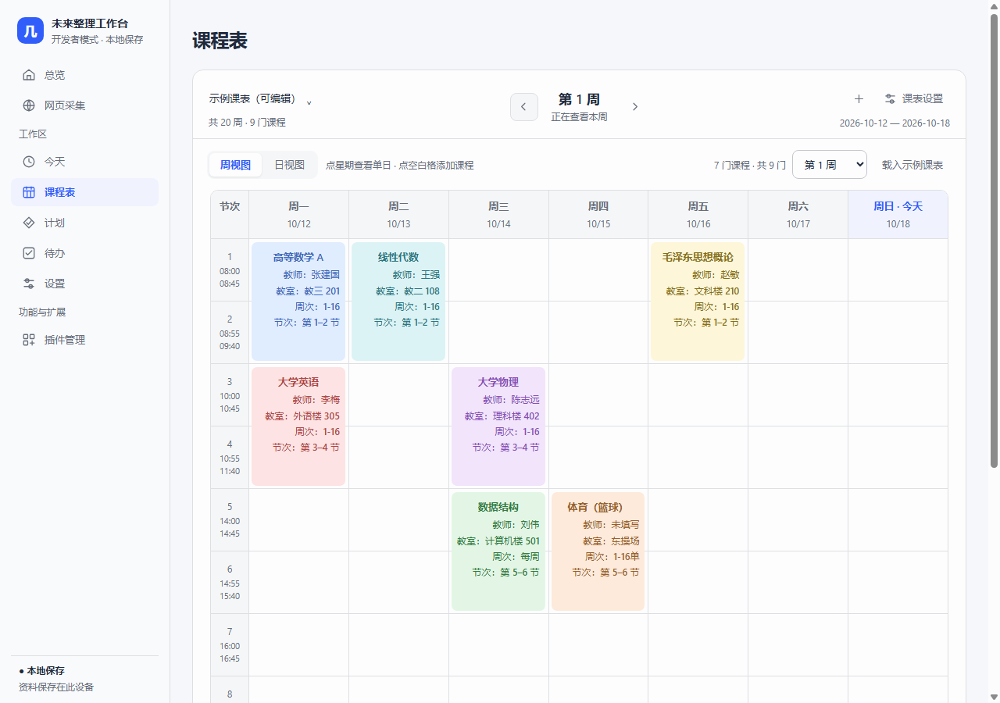
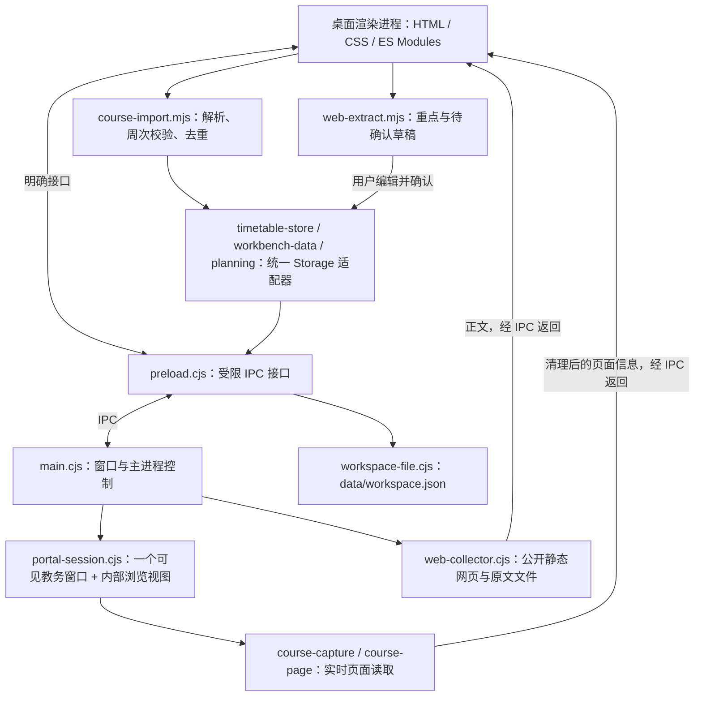

# 几微 · JeeWeave Desktop

面向 Windows 的本地工作台。当前提供课程表、今天、统一事项（待办、事件/考试及计划）、南邮教务课表导入、公开网页整理与待办/计划日历；界面与 Web 客户端分别维护。群消息开发暂停，入口与接收已停用，代码及历史资料保留。

2026-10-21 本地开发版已实现[笔记首版](../docs/product/随记功能与开发流程.md)及[内置业务宿主的首片适配](../docs/design/插件化底座与迁移流程.md)。笔记独立记录和保存，其他业务保留原模型；10 月 22 日已接通对象归属/确认提炼事项与普通事项多段安排。以上功能已纳入 0.3.0 Windows 交付，也可使用 debug.cmd 运行源码。



*截图来自隔离测试，使用虚构课程；侧栏仅显示已开启功能。*

## 技术框架

| 层次 | 当前实现 | 职责 |
| --- | --- | --- |
| 桌面运行时 | Electron 44.7.0 | 提供 Chromium、Node.js、窗口及进程生命周期 |
| 主进程 | Node.js + CommonJS `.cjs` | 管理主窗口/教务窗口、IPC、网络采集和文件操作 |
| Preload | `contextBridge` + `ipcRenderer` | 暴露明确的调用接口，连接界面与主进程 |
| 界面 | 原生 HTML/CSS、JavaScript ES Modules | 导航、课表网格、表单、主题和状态反馈 |
| 动效 | Web Animations API | 可打断的切页动效及减少动态效果分支 |
| 教务浏览 | `BrowserWindow` + `WebContentsView` | 登录页面、站点弹出上下文、当前课表页面 |
| 课程提取 | 隔离脚本环境、帧树读取、规则解析 | 从实时 DOM 读取课程、校验字段并准备导入 |
| 本地业务存储 | 版本化 `workspace.json` + 原子文件替换 | 多课表、课程、作息、计划、待办、设置及网页记录；localStorage 为兼容缓存 |
| 网络与文件 | Node.js `fetch`、`fs` | 公开静态网页读取、原文和元数据保存 |
| 公共日期模块 | `shared/packages/core/src/semester-calendar.mjs` | 上海日期、教学周及星期计算 |
| 封装 | electron-builder 26.15.3 | Windows x64 免安装文件夹，源码放入 `app.asar` |
| 验证 | `node:test`、真实 Electron 隔离测试、PowerShell | 逻辑、交互、教务模拟及最终 exe 启动/退出 |

版本取自当前锁文件。桌面渲染层直接加载本地 HTML/MJS，开发时无需启动 Vite。当前桌面业务数据走自己的快照存储；Web 使用的 Dexie 仓储、React UI 和平台适配尚未统一接入桌面。

## 进程与模块关系



主工作台之外最多保留一个可见教务窗口。站点自己的弹出登录/跳转上下文由 `WebContentsView` 承载在该教务窗口内，保留 Chromium 的 POST、来源及会话行为。关闭主工作台会销毁本实例的窗口/视图并退出应用。

桌面主窗口使用隐藏系统标题文字的标题栏与原生窗口按钮，顶部空白区域可拖动，顶部拖动栏与侧边栏同色，原生按钮背景和符号随浅色/深色/自定义主题同步更新；不恢复原生菜单。侧栏图标右侧显示“JeeWeave · 几微”，英文主名与中文辅助名保持单行、基线和紧凑留白；窄窗口适度缩小图标与文字，不截断名称。图标以微小节点和相交织线表示“把课程、待办、计划织成有序的一天”，SVG 为源稿，同源导出窗口 PNG 与多尺寸 Windows ICO；当前已接入开发窗口及后续打包配置，既有 Release 未改变。

课表设置、课程编辑、单次调整、文件导入预览和事项编辑共用原生 dialog、焦点限制、Escape/遮罩关闭及滚动恢复。弹出栏最大宽度统一为 820px，窗口较窄时按主体可用空间收缩；标题左对齐、关闭按钮靠右、正文留白一致，表单控件至少 40px。导入导出的说明与操作分行，按钮整项换行；批量课程与文件预览的名称和周次占整行，教师/地点并列，星期/节次为一组，不压缩按钮文字。课表每节基础高度为 64px，内容可继续撑高，完整文字和窄屏自身横向滚动保留。页面、视图及弹窗切换为 120ms、0.88→1 的纯淡入，无上移/缩放/模糊；系统减少动态效果时不播放动画。

### 教务课表导入

1. 进入「课程表 → 课表设置 → 导入/导出」。
2. 打开南邮 WebVPN 登录入口，手动完成账号登录与验证码，进入学生课表查询并查询学期。
3. 回到几微点击「抓取并导入」。
4. 主进程读取当前教务内容：优先使用隔离脚本环境；需要时读取帧树，并保留正文兜底。
5. 渲染层规则解析课程名、教师、地点、星期、节次、周次与单双周；校验关键字段、去重后一次保存到本次选择的课表。

列表按 DOM 行列及合并单元格还原，兼容同一节次单双周不同教室；备用正文解析也保留继承节次。列表数量不完整或与网格安排冲突时整批拒绝，避免部分成功却悄悄漏课。网格教师/地点支持图标后相邻文字。“其它课程”独立保存在课表下方的待安排清单，按原文保留、不虚构星期节次。从南邮域名导入且当前仍使用通用默认作息时，使用[学校本学期官方时间表](https://jwc.njupt.edu.cn/2026/0917/c1594a308644/page.htm)校正 12 节时间；自定义作息和其他学校保持原样，开学日仍需核对。完整备份用工作区 JSON，CSV 仍只包含定时课程。

课程抓取原文不作为 TXT/HTML 文件自动落盘。可用的清理后 HTML 在应用内只读展示；设置中的开发者模式额外展开原始文本和读取状态。错误或抓取期间切换课表会阻止不完整写入。课表设置与添加/编辑使用局部覆盖面板，背景课表保持可见；面板内滚动，主内容区暂时锁定，关闭后恢复原位置。

该链路已通过一次真实南邮账号的用户验收，并有本地模拟回归。学校认证入口、页面布局或网络策略变化后仍可能需要适配；其他学校未验证。

### 单次调课、停课与恢复

先选具体教学周，点击课程后选择“调整 / 停课这一次”。可改调入日期、节次和地点，或只停这一次；在原位置保留调出/停课标记，点击后可恢复。今天页与日历详情也有调整/恢复入口；编辑整门课程仍影响模板。尚未设置开学日或处于全部周次时，不猜测某一次课。

课次以课程 ID + 原日期识别，调入后身份不变。修改学期起点、周次或节次会使已有调整失效时，先阻止保存并提示恢复相关调整；删整门课程时一并清理其调整。课程、今天、日历和 ICS 读取同一投影，有效调入为 normal，调出为 moved，停课为 cancelled。

### 课程文件与批量编辑

课表设置 → 导入/导出提供 CSV/ICS。先预览、编辑字段、查看错误/重复/冲突，再确认整批保存；取消不写入，错误行需修正或明确取消选择，读取及预览期间课表变化会阻止旧预览覆盖。CSV 支持中文/英文表头、引号、换行及单双周；相同内容与等价周次去重，冲突只提醒而保留用户选择。文件上限 4 MiB，预览最多 2000 行。

ICS 导入按当前学期和作息还原具体课程，支持 UTC、北京时间/上海时区、每周重复（BYDAY/INTERVAL/COUNT/UNTIL）、EXDATE/RDATE。其他时区、秒级时刻、复杂重复或 RECURRENCE-ID 系列会明确保留错误行，需先展开为独立课次或修正文件；不将不支持的系列偷减成第一节。课程必须匹配作息且在学期内，不支持所有任意日历文件。导出 ICS 包含实际有效课次，省略停课和调出，保留调入、稳定 UID、教师地点及 UTF-8 折行；CSV 导出仍为模板，完整调整历史使用工作区 JSON。

批量编辑现可修改名称、教师、地点、星期、起止节次、周次；所有行验证后一次保存，原 ID、创建时间、来源和颜色保留。

### 今天与阅读显示

今天页按北京时间显示上课中/下一节，含实际起止、地点和调停课状态，结束时刻不计为上课中；显示期间每 30 秒更新。未设开学日提示补设，不伪造第一周。

本地开发版的主页只列明确包含今天的事项：今天截止、日期区间覆盖今天、今天的重复安排或执行时段。无期限、以前逾期但今天未安排、其他日期的未完成事项集中在右上角「其他待处理事项」弹窗，分为已逾期、未定日期、其他日期；不混入今日计数。今日事项、弹窗分组及每条事项详情均可展开/收起，同次运行的刷新和切页保留状态。打开事项仍编辑原记录，分流与折叠不改变日期、完成状态或数据。

设置 → 阅读与显示可切标准/大字、紧凑/宽松。字号作用于课程、今天、事项和日历正文；宽松将课表基础行高从 64px 增至 82px，正文仍可撑高。偏好随 data/JSON 迁移和恢复。重叠课程按数量扩宽日期列，课表内部水平滚动，不把多个课程挤成单字竖列。

### 换版本或换电脑

本地开发版：设置 → 数据迁移与备份 →「导出迁移包」，得到一个 .jiwei 文件；在新版点击「导入迁移包 / JSON」，核对数量和兼容提示后确认。课程、事项、笔记、对象、设置和独立原文一起迁移；当前资料在替换前自动备份。登录状态与接入密钥不随包迁移。

旧版没有迁移包按钮时，直接在新版选择「从旧版文件夹迁移」，选旧应用文件夹或 data；已有桌面 JSON 也可导入。仅有 profile 的早期版本需先用旧版导出 JSON。新格式不兼容时会拒绝导入，原资料保留。迁移包超过容量限制时仍可退出应用后整体复制 data；详细限制与恢复方法见[数据格式](DATA_FORMAT.md)。

### 周次、作息与配色

“课程表”页标题位于课表边框外左上，与其他功能页一致。边框内保留三栏顶部：左侧课表名与小字统计、中间上下周/回本周、右侧添加与设置及日期。点击左侧课表名进入管理和切换，周次选择在网格工具行；设置中不再重复放置周次操作，首尾周禁用对应方向。无课程时显示导入/手动添加入口，不重复铺空网格；已有课程但当前周/日无课时仍保留网格。

添加和设置面板限制在课表可见区域内，宽窗口只覆盖一部分课表，窄窗口自适应宽度；支持 Escape、关闭按钮与点击遮罩取消，键盘焦点留在面板中，关闭返回原入口。课程标题 13px、课程信息 12px、时间刻度至少 11px，普通说明/表单为 13px。

课程卡片参照[已部署网页版](https://arrsk.github.io/jiwei/)的七组浅底同色系文字，深色/自定义主题继续适配对比度。课名居中，教师、教室、周次和节次分行显示，长文字完整换行，不加省略号；网格每节至少 64px，随内容增高，同节次课程并排而不遮盖。添加/编辑采用标签行、起止节次下拉、自动/七色选项、全周/单周/双周及逐周按钮；取消不保存，非法周次或保存失败保留草稿，编辑保留课程 ID 与创建时间。

「课表设置 → 作息时间」可批量安排上午、午后、晚间的开始时间与节数，以及每节课长、普通课间隔、大课间频次和总间隔。先生成时间预览，可逐节微调，最后保存到当前课表；不影响其他课表。某时段填 0 节可关闭，大课间会替代普通间隔并按时段重新计数。重叠、跨午夜或减少节数影响已有课程时会阻止保存。

「设置 → 主题与文字」有 9 套预设，推荐清晨蓝白（日常）、米白书页（阅读）、松林浅绿（学习）和深海夜读（深色）；另有浅雾紫、玫瑰灰、海盐青、琥珀暖光、石墨深灰。每套同时调整背景、正文、面板、按钮与课程卡片。还可自定义背景、文字和强调色，预览后应用；正文与背景对比不足时给出提示。选择和颜色随 workspace.json 保存，升级时一同迁移。

### 插件管理

左侧「插件管理」提供今天、课程表、事项、对象视图、笔记、网页采集、教务导入和日历，共八项开关。事项开关一次保存旧 plans/tasks 两项偏好；读取旧版单边开关时保留原值，显示部分开启状态，主动切换后统一控制。关闭后收起入口及总览/今天中的相关内容，数据保留，重新开启继续使用；开关随 data 迁移。课程表关闭时教务导入暂停，原开关选择保留；教务导入可单独关闭，CSV 不受影响。事项关闭时仍可整理网页，确认加入事项需要先开启事项。示例只在开发者模式提供。

总览、设置和插件管理始终可用；记账、外部 AI 暂列在未实现说明中。当前管理的是内置功能，没有第三方插件下载安装或任意代码执行。侧栏底部提供本地保存提示和「记一笔」，配色统一在设置中调整，侧栏暂不显示滚动条。

### 公开网页整理

左侧「网页采集」使用主进程 `fetch` 读取公开静态 HTML/文本，保存原文与元数据，再由本地规则整理重点、日期和行动草稿。用户核对标题、日期并确认后才加入待办。普通网页采集独立于教务登录会话。

当前没有外部 AI 模型调用；依赖浏览器执行脚本才能出现正文的网站不在这个采集器的支持范围。

### 事项与日历

左侧“事项”合并原计划、待办两个入口，使用同一列表、添加/编辑弹窗和完成操作。按待办、事件/考试、阶段计划、重复及已完成筛选；时间安排可选有截止时间、无期限、事件/考试（同一选项）、全天、跨日/阶段计划或每周重复。当天事件与考试直接填写日期、开始和结束时间；跨日计划可加阶段，执行区间和完成期限分别保存。

事件与考试共用“事件 / 考试 · 当天时段”；旧 eventType=exam 标记仍保留，打开同一选项且不清空时间。

旧数据不按标题去重或搬动集合。原 tasks/plans 的 ID、来源、创建时间和完成记录继续保留；旧待办改成考试或阶段计划时仍更新原条记录。新建无期限/截止事项优先写 tasks，其余优先写 plans，兼容旧版单边开关时使用仍开启的集合；界面分类按时间语义，不按历史集合。Web 仍独立，未改其计划/待办界面。

日历默认月视图，可切周/日、今天、前后日期和日期跳转。月视图直接显示时刻，拥挤时优先保留带时间和截止的条目；“另几项”查看当天完整清单。周/日按起止时间绘制事件、考试、带时段的区间及每周安排；具体截止时间显示为时间点，不占用虚构时段。没有时刻的安排和截止仍在全天栏；相交时段分列，短事项和日末截止保留可点高度，实际时间不变。统一按北京时间显示。

点击事项查看详情、备注和阶段，可完成或进入同一编辑器。每周重复只完成本次。日历只有一个添加事项入口，默认带入所选日期；无日期内容保留在独立清单。“事项”显示筛选同时控制旧两份来源，旧单边筛选先保留并显示部分选中状态。已有事项没有复制成第二套日历数据。

示例只在开发者模式出现，事项/日历示例包含考试、具体截止、事件、阶段和重复。日期/视图/筛选切换沿用轻量可打断淡入；减少动态效果时不播放。课程课次已接入同一日历，提供课程筛选和单次调整/整门编辑回跳；仍不支持拖拽改期、订阅或同步。实现记录见[日历说明](../docs/research/CALENDAR.md)。

### 笔记（本地开发版）

进入侧栏「笔记」、底部「记一笔」，或在应用内按 Ctrl/Cmd+Shift+M 打开编辑器。直接键入多行文字，标题、标签均可不填，可补记日期，用途可选见闻、感受、想法、摘录或复盘，默认未分类；Ctrl/Cmd+Enter 保存为记录。未提交的输入即时保存为草稿，关闭后可以继续写。

按日时间轴支持关键词、日期、用途及标签筛选，长文可打开全文。归档和回收站入口收在「更多」中。笔记可以编辑、归档、移入回收站和恢复；永久删除需再次确认。单篇可导出纯文本 Markdown；完整恢复使用工作区 JSON，含草稿和已关闭模块的数据。所有内容保存在同一 data，普通模式隐藏且禁止导入虚构示例。

保存失败保留输入并显示重试，阻止关闭编辑器、离开页面或停用笔记；此时关闭应用会提示返回保存或明确放弃未保存内容。正常已落盘草稿不拦截退出。笔记支持关联一个课程/项目对象，并从对象返回原笔记；选取正文后可确认提炼事项。富文本、附件、正文历史和系统全局笔记快捷键尚未实现。

现有内置功能已统一接入插件底座：服务版本与依赖检查、命令/原记录路由、命名空间、原子事务和生命周期。课程读写及导入、事项、对象、笔记、网页采集均由提供者负责，今天/日历/总览只读聚合；停用撤销监听与服务，重新开启不重复注册。工作区与旧数据格式不变，恢复失败回滚；主进程再次检查采集/教务权限，过期异步结果不写入。当前支持可信内置代码，第三方插件安装和跨端运行时未实现。详见[接口与代码入口](../docs/development/内置插件接口.md)及[架构](../docs/ARCHITECTURE.md)。

### 笔记与执行安排的连用（本地开发版）

在已保存笔记下展开「关联课程或项目」，选择对象并保存；可改归属或选独立笔记解除，原文不变。对象页的「笔记」分组也能关联和打开原记录，关闭功能保留关系。

先选中笔记正文，再点「提炼为事项」；不选时使用前 4000 字作为原文依据，修改事项名称、可选截止与归属后「确认创建事项」。界面分别提示笔记修改草稿、提炼草稿已保存和尚未创建事项；草稿落盘不会自动成为笔记或事项。关闭只留下提炼草稿；可继续或明确放弃。保存失败保留输入并提供「重试保存草稿」，确认失败可再次确认。同一次确认不重复创建，事项有「返回原笔记」，原文不因完成事项而消失。长文可在原笔记编辑框选中文字后点击「保存并提炼选文」：先保存当前笔记，再提炼选中内容。

普通非重复事项编辑器提供「执行安排」：增删多段起止日期/时间与可选说明，上限 100 段。执行时段跟随原事项、只有一份完成状态；截止独立，时间过去不自动完成。跨日结束为次日 00:00 时不占用次日。阶段/重复事项暂不提供新组合，先移除独立时段才能切换为这些类型，旧行为继续保留。

今天页每件事只显示一次，列出当天各段与所属对象；日历显示虚线「执行」时段，截止保留独立时间点，多入口都编辑/完成同一个事项。提炼草稿、来源引用、归属和执行时段一起保存在原 data/workspace.json，完整 JSON 和整目录迁移均保留；已纳入 0.3.0。

### QQ / 微信群消息（暂停）

按用户要求暂停开发，侧栏与插件管理均不展示，主进程拒绝启动接收和读取接入密钥，即使旧资料的开关为开启也不会监听。不删除原模块、适配器、单测、历史消息、来源、密钥或缓冲；备份与整目录迁移仍保留历史资料。先前协议阶段的实现和正常 QQ 登录/历史公告文件需求保存在[群消息调研](../docs/research/CHAT_MONITOR.md)，不把规划描述成已实现。

## 本地运行

以下命令均在**仓库根目录**执行。准备 Node.js 22.12+ 和 `package.json` 指定的 pnpm 11.25.0；当前本机验证使用 Node 24。

```sh
pnpm install --frozen-lockfile
pnpm exec install-electron
pnpm desktop:run
```

`install-electron` 下载/检查当前依赖版本的 Electron 运行时，首次需要网络，已有运行时会复用。Windows 也可双击本目录的 `debug.cmd` 启动。两种入口使用同一界面；在“设置 → 开发者模式”主动开启后，示例导入和教务原文调试才会出现，选择会保存。

如果 pnpm 包装器受本地网络/权限影响，可从仓库根目录直接使用已安装工具：

```sh
node node_modules/electron/cli.js desktop/main.cjs
```

本机 Node.js 是开发/打包工具；最终免安装成品自带运行时，使用者无需安装 Node.js 或 Python。

## 数据与备份

| 数据 | 当前位置/方式 |
| --- | --- |
| 开发版数据 | `desktop/data/`，首次从旧默认 profile 复制迁移，原件保留 |
| 成品数据 | exe 同级 `data/`，含业务文件和会话/资源子目录 |
| 业务主文件 | `data/workspace.json`，格式和 schemaVersion 均有标识 |
| 登录及兼容缓存 | `data/profile/`，不能当普通缓存删除 |
| 成品磁盘缓存 | `data/cache/` |
| 网页原文/元数据 | `data/captures/web-captures/` |
| 日志/崩溃资料 | `data/logs/` |
| 课程文件 | CSV 导入/导出 |
| 桌面 JSON | 导出至 `data/exports/`；恢复前预览数量、确认并备份旧快照 |

当前源码推荐使用设置内的迁移包或旧版文件夹导入，步骤见上文「换版本或换电脑」。公开 0.2.1 仍需退出后整体复制 data；开发资料不会自动混入成品，Web 也不自动同步。文件格式和恢复边界统一见 [DATA_FORMAT](DATA_FORMAT.md)。

待办管理有期限/无期限的单步行动，按逾期、今天、接下来、无期限与完成分组；计划管理截止、长期、区间、定时/全天、每周重复事项。区间可拆阶段并分别勾选，执行时间与硬截止分别保存。两者共用事项结构，保留旧 ID、完成与来源信息，入口不重复。

## 安全边界

- 本地界面通过 preload 调用明确的 IPC 通道；渲染层关闭 Node 集成，开启上下文隔离和沙箱。
- 教务内容保留 `webSecurity`、上下文隔离与沙箱；页面读取由主进程协调，不更改远端页面的安全设置。
- 登录由用户在学校页面完成；原文展示前移除输入控件，来源查询参数在抓取结果中清理。页面正文仍可能包含个人资料，不应上传真实原文、profile、Cookie 或运行日志。
- 当前 IPC 实现提供固定功能接口；尚未做独立的安全审计，不以这些设置代替完整安全评估。

实现依据可对照 Electron 官方的[进程模型](https://www.electronjs.org/docs/latest/tutorial/process-model)、[WebContentsView](https://www.electronjs.org/docs/latest/api/web-contents-view) 与 [webContents API](https://www.electronjs.org/docs/latest/api/web-contents)。

## Windows 封装

在 Windows x64 上，从仓库根目录执行：

```sh
pnpm exec install-electron
pnpm desktop:package
```

公开下载：[0.3.0 Release](https://github.com/ArrSk/jiwei/releases/tag/v0.3.0) · [Windows x64 ZIP](https://github.com/ArrSk/jiwei/releases/download/v0.3.0/jeeweave-0.3.0-Windows-x64.zip)。下载后完整解压，双击文件夹内的“几微.exe”。

当前 0.3.0：`desktop/release/几微-0.3.0-Windows-20261023-070339/几微.exe`。最终目录连续两次普通启动与退出通过；ZIP 解压副本验证见[打包记录](../docs/development/桌面打包进度.md)。升级优先使用迁移包或旧文件夹导入，分发 data 为空；本机 0.2.1 保留作回退，含数据的 0.1.0 目录保留。

成品在 `desktop/release/几微-版本-Windows-UTC时间/`，双击其中的 `几微.exe`。打包脚本使用本机已安装的 Electron 分发，复制配套 DLL/资源，按白名单生成 `app.asar`，并附使用说明、BUILD-INFO.json（版本与运行源码指纹）、SHA256SUMS.txt（exe/asar 校验）。完成两次原目录普通启动后清除探测资料，生成完整 ZIP 及其 .sha256；latest-build.json 记录本机最新产物。仅删除本次生成的 staging，不清理旧 data。

报告成功前，脚本会在**最终目录**连续两次无调试参数启动 exe，确认窗口、持久存储文件和关窗后的进程清理。之后仍应将最终 ZIP 解压到隔离目录，再运行 `package-smoke.cjs` 验证版本/校验、示例、日历、暂停接收、采集、移动恢复及关窗清理。Windows 关闭验证轮询实际进程；短暂文件句柄延迟使用有界等待，不依赖 .NET 重定向句柄的 WaitForExit。

当前成品未做可信数字签名、自动更新或安装器。Windows 可能提示应用不受识别；签名和应用信誉说明见[微软官方文档](https://learn.microsoft.com/en-us/windows/apps/package-and-deploy/smartscreen-reputation)。macOS/Linux 成品尚未封装验收。

## 验证

```sh
pnpm desktop:test
pnpm desktop:test:portal
pnpm desktop:test:close
pnpm desktop:test:capture
pnpm desktop:test:capture-vpn
pnpm desktop:test:import-ui
pnpm desktop:test:workbench-ui
pnpm desktop:test:features
pnpm desktop:test:workspace
pnpm desktop:test:reset
```

最终成品可额外运行（将路径替换为实际成品目录，并先关闭该成品）：

```powershell
powershell.exe -NoProfile -File desktop/tests/package-native.ps1 -PackageDirectory "desktop/release/实际成品目录"
node desktop/tests/package-smoke.cjs "desktop/release/实际成品目录"
```

隔离交互测试使用虚构数据和本地 HTTP 页面，不应填入真实账号。新增 workspace 回归运行实际主进程/preload，覆盖新增编辑、阶段、数据文件落盘、重启、清缓存恢复、复制 data 至新版本及确认恢复/备份；各轮实际检查范围见 [HANDOVER](../docs/HANDOVER.md)。

## 当前边界

### 对象视图 Beta

侧栏“对象视图 Beta”支持新建课程、项目或主题，填写目标与背景；把同一门课的多个排课入口、作业/考试/计划及网页资料显式关联到一个对象。详情分为上课安排（含下次实际课次）、事项与计划（含时间和阶段）、网页资料与要求（含原文），可以跳回原编辑器，课程/事项/网页也提供返回所属对象入口。对象中“添加关联事项”预填归属，事项与关联同次保存。普通使用无需开发者模式，可在插件管理中关闭对象入口。

同名内容不自动合并，一条记录有一个主归属；解除关系不删除原内容，归档对象不完成或隐藏它的未完成事项。删除来源后保留可解除的关系与标题提示，不级联删除对象其他内容。当前不支持多对象相关引用、单次课来源归属、阶段/重复事项的独立多段执行、费用/笔记附件、通用资料用途分类。

所有示例导入只允许在开发者模式开启后执行。关闭后隐藏示例课表、事项、日历投影、网页和对象以及入口；底层资料保留，重新开启可见。示例网页草稿确认生成的事项继承示例标记。导出完整 JSON 仍保留隐藏示例；不会因为界面筛选而删除数据。

### 开发者清空数据

“设置 → 开发者模式”开启后出现“清空所有数据”。打开确认页查看数量和范围，勾选确认后点击“备份、清空并重启”。它会重置真实/示例课表、待安排课程、事项、对象及关联、网页原文、设置、教务登录状态和缓存；开发者模式恢复关闭。取消、普通模式或过期确认不会清空。

主程序先提交重启请求，旧进程退出后、登录会话初始化前，将当前数据移入同一目录的 `data/backups/before-clear-时间戳-编号/data/`；已有 backups 保留，成功后以空白环境启动。该位置保存完整原文件，不仅是业务 JSON；执行失败会尝试回滚并保留状态清单。恢复业务内容可选择其中的 workspace.json；恢复全部环境请先完全退出几微，把当前 data 另存，再将该备份 data 内的内容恢复到使用中的 data，不要合并运行中的 profile。没有执行此功能时不会清理实际资料。

桌面尚未接入 Web Dexie 仓储、跨端同步、原生闹钟、自动更新、第三方插件运行时或外部 AI。JSON 恢复使用桌面格式，不能直接恢复 Web 备份。未实现说明中的项目不计入已实现能力。

代码导航见[文件用途索引](../docs/文件用途索引.md)，返回[项目首页](../README.md)。

两端逐项差异见[功能对照](../docs/development/桌面与网页版功能对照.md)，本轮推荐移植已完成，具体能力和 ICS 限制以本文及最新交接记录为准。
