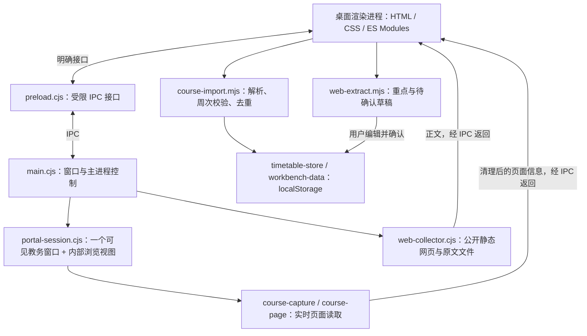

# 几微 Desktop

面向 Windows 的本地工作台。当前提供课程表、今天、计划、待办、南邮教务课表导入和公开网页整理；界面与 Web 客户端分别维护。


*截图来自隔离测试，使用编辑过的虚构示例；左侧记账、笔记、AI、插件仍是占位入口。*

## 技术框架

| 层次 | 当前实现 | 职责 |
| --- | --- | --- |
| 桌面运行时 | Electron 44.7.0 | 提供 Chromium、Node.js、窗口及进程生命周期 |
| 主进程 | Node.js + CommonJS `.cjs` | 管理主窗口/教务窗口、IPC、网络采集和文件操作 |
| Preload | `contextBridge` + `ipcRenderer` | 暴露明确的调用接口，连接界面与主进程 |
| 界面 | 原生 HTML/CSS、JavaScript ES Modules | 导航、课表网格、表单、主题和状态反馈 |
| 动效 | Web Animations API | 可打断的切页动效及减少动态效果分支 |
| 教务浏览 | `BrowserWindow` + `WebContentsView` | 登录页面、站点弹出上下文、当前课表页面 |
| 课程提取 | 隔离脚本环境、帧树读取、规则解析 | 从实时 DOM 读取课程、校验字段并准备导入 |
| 本地业务存储 | `localStorage` 快照 | 多课表、课程、作息、计划、待办及网页记录 |
| 网络与文件 | Node.js `fetch`、`fs` | 公开静态网页读取、原文和元数据保存 |
| 公共日期模块 | `shared/packages/core/src/semester-calendar.mjs` | 上海日期、教学周及星期计算 |
| 封装 | electron-builder 26.15.3 | Windows x64 免安装文件夹，源码放入 `app.asar` |
| 验证 | `node:test`、真实 Electron 隔离测试、PowerShell | 逻辑、交互、教务模拟及最终 exe 启动/退出 |

版本取自当前锁文件。桌面渲染层直接加载本地 HTML/MJS，开发时无需启动 Vite。当前桌面业务数据走自己的快照存储；Web 使用的 Dexie 仓储、React UI 和平台适配尚未统一接入桌面。

## 进程与模块关系



主工作台之外最多保留一个可见教务窗口。站点自己的弹出登录/跳转上下文由 `WebContentsView` 承载在该教务窗口内，保留 Chromium 的 POST、来源及会话行为。关闭主工作台会销毁本实例的窗口/视图并退出应用。

### 教务课表导入

1. 进入「课程表 → 课表设置 → 导入/导出」。
2. 打开南邮 WebVPN 登录入口，手动完成账号登录与验证码，进入学生课表查询并查询学期。
3. 回到几微点击「抓取并导入」。
4. 主进程读取当前教务内容：优先使用隔离脚本环境；需要时读取帧树，并保留正文兜底。
5. 渲染层规则解析课程名、教师、地点、星期、节次、周次与单双周；校验关键字段、去重后一次保存到本次选择的课表。

课程抓取原文不作为 TXT/HTML 文件自动落盘。可用的清理后 HTML 在应用内只读展示；调试模式额外展开原始文本和读取状态。错误或抓取期间切换课表会阻止不完整写入。

该链路已通过一次真实南邮账号的用户验收，并有本地模拟回归。学校认证入口、页面布局或网络策略变化后仍可能需要适配；其他学校未验证。

### 公开网页整理

左侧「网页采集」使用主进程 `fetch` 读取公开静态 HTML/文本，保存原文与元数据，再由本地规则整理重点、日期和行动草稿。用户核对标题、日期并确认后才加入待办。普通网页采集独立于教务登录会话。

当前没有外部 AI 模型调用；依赖浏览器执行脚本才能出现正文的网站不在这个采集器的支持范围。

## 本地运行

以下命令均在**仓库根目录**执行。准备 Node.js 22.12+ 和 `package.json` 指定的 pnpm 11.8.0；当前本机验证使用 Node 24。

```sh
pnpm install --frozen-lockfile
pnpm exec install-electron
pnpm desktop:run
```

`install-electron` 下载/检查当前依赖版本的 Electron 运行时，首次需要网络，已有运行时会复用。Windows 也可双击本目录的 `debug.cmd` 开启原文调试；普通开发启动不设置调试环境变量。

如果 pnpm 包装器受本地网络/权限影响，可从仓库根目录直接使用已安装工具：

```sh
node node_modules/electron/cli.js desktop/main.cjs
```

本机 Node.js 是开发/打包工具；最终免安装成品自带运行时，使用者无需安装 Node.js 或 Python。

## 数据与备份

| 数据 | 当前位置/方式 |
| --- | --- |
| 开发版数据 | Electron 的默认 `userData`，Windows 通常在 `%APPDATA%/jiwei`；以运行时实际路径为准 |
| 成品持久资料 | exe 同级 `data/profile/`，含 localStorage、设置及教务登录会话 |
| 成品磁盘缓存 | `data/cache/` |
| 网页原文/元数据 | `data/captures/web-captures/` |
| 日志/崩溃资料 | `data/logs/` |
| 课程文件 | CSV 导入/导出 |
| 桌面 JSON | 可导出本地数据快照，尚未提供对应 JSON 导入恢复 |

`data/profile` 包含业务数据，不能当普通缓存清理。备份/移动前退出应用，再复制整个成品文件夹；升级时保留旧版备份，把完整 `data` 复制到新版。开发资料不会自动复制进成品，Web 的 IndexedDB 也不会自动同步进来。跨电脑的登录 Cookie 可用性未验证。

## 安全边界

- 本地界面通过 preload 调用明确的 IPC 通道；渲染层关闭 Node 集成，开启上下文隔离和沙箱。
- 教务内容保留 `webSecurity`、上下文隔离与沙箱；页面读取由主进程协调，不更改远端页面的安全设置。
- 登录由用户在学校页面完成；原文展示前移除输入控件，来源查询参数在抓取结果中清理。页面正文仍可能包含个人资料，不应上传真实原文、profile、Cookie 或运行日志。
- 当前 IPC 实现提供固定功能接口；尚未做独立的安全审计，不以这些设置代替完整安全评估。

实现依据可对照 Electron 官方的[进程模型](https://www.electronjs.org/docs/latest/tutorial/process-model)、[WebContentsView](https://www.electronjs.org/docs/latest/api/web-contents-view) 与 [webContents API](https://www.electronjs.org/docs/latest/api/web-contents)。

## Windows 封装

在 Windows x64 上，从仓库根目录执行：

```sh
pnpm exec install-electron
pnpm desktop:package
```

成品在 `desktop/release/几微-版本-Windows-UTC时间/`，双击其中的 `几微.exe`。打包脚本使用本机已安装的 Electron 分发，复制配套 DLL/资源，按白名单生成 `app.asar`，并附使用说明。

报告成功前，脚本会在**最终目录**连续两次无调试参数启动 exe，确认窗口、持久存储文件和关窗后的进程清理。之后仍应运行 `package-smoke.cjs`，在副本验证实际功能和移动恢复。

当前成品未做可信数字签名、自动更新或安装器。Windows 可能提示应用不受识别；签名和应用信誉说明见[微软官方文档](https://learn.microsoft.com/en-us/windows/apps/package-and-deploy/smartscreen-reputation)。macOS/Linux 成品尚未封装验收。

## 验证

```sh
pnpm desktop:test
pnpm desktop:test:portal
pnpm desktop:test:close
pnpm desktop:test:capture
pnpm desktop:test:capture-vpn
pnpm desktop:test:import-ui
pnpm desktop:test:workbench-ui
pnpm desktop:test:features
```

最终成品可额外运行（将路径替换为实际成品目录，并先关闭该成品）：

```powershell
powershell.exe -NoProfile -File desktop/tests/package-native.ps1 -PackageDirectory "desktop/release/实际成品目录"
node desktop/tests/package-smoke.cjs "desktop/release/实际成品目录"
```

隔离交互测试使用虚构数据和本地 HTTP 页面，不应填入真实账号。当前本地验证记录：31 项桌面单测，设置/导入/网页采集/退出/成品启动与移动恢复的分项回归；各轮实际范围见 [HANDOVER](../docs/HANDOVER.md)。

## 当前边界

桌面还没有 Web 端的单次调停课、ICS 导入导出及 JSON 恢复，也没有统一仓储迁移、跨端同步、原生闹钟、自动更新、可运行插件或外部 AI。界面中的相应占位入口不计入已实现能力。

代码导航见[文件用途索引](../docs/文件用途索引.md)，返回[项目首页](../README.md)。
