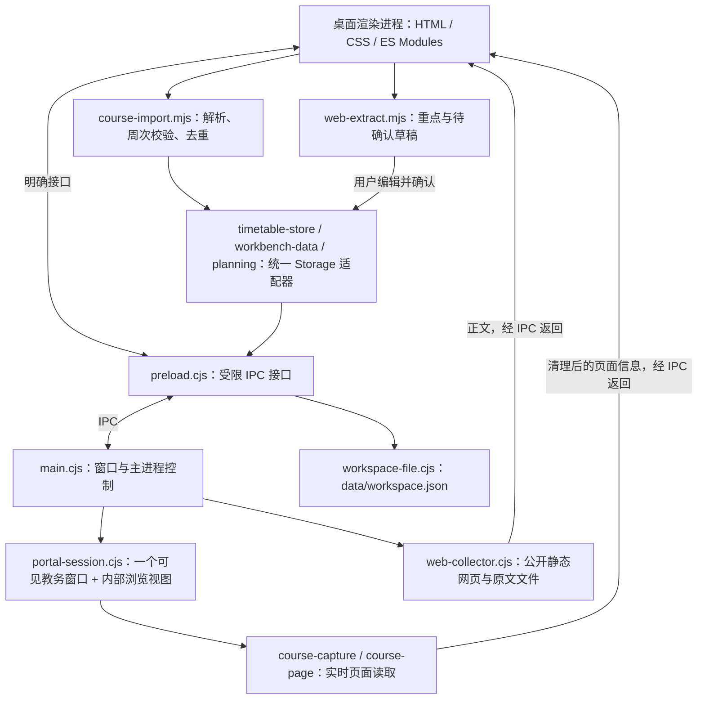

# 几微 Desktop

面向 Windows 的本地工作台。当前提供课程表、今天、计划、待办、南邮教务课表导入、公开网页整理与待办/计划日历；界面与 Web 客户端分别维护。群消息开发暂停，入口与接收已停用，代码及历史资料保留。


*截图来自隔离测试，使用虚构课程；侧栏仅显示已开启功能。*

## 技术框架

| 层次 | 当前实现 | 职责 |
| --- | --- | --- |
| 桌面运行时 | Electron 44.7.0 | 提供 Chromium、Node.js、窗口及进程生命周期 |
| 主进程 | Node.js + CommonJS `.cjs` | 管理主窗口/教务窗口、IPC、网络采集和文件操作 |
| Preload | `contextBridge` + `ipcRenderer` | 暴露明确的调用接口，连接界面与主进程 |
| 界面 | 原生 HTML/CSS、JavaScript ES Modules | 导航、课表网格、表单、主题和状态反馈 |
| 动效 | Web Animations API | 可打断的切页动效及减少动态效果分支 |
| 教务浏览 | `BrowserWindow` + `WebContentsView` | 登录页面、站点弹出上下文、当前课表页面 |
| 课程提取 | 隔离脚本环境、帧树读取、规则解析 | 从实时 DOM 读取课程、校验字段并准备导入 |
| 本地业务存储 | 版本化 `workspace.json` + 原子文件替换 | 多课表、课程、作息、计划、待办、设置及网页记录；localStorage 为兼容缓存 |
| 网络与文件 | Node.js `fetch`、`fs` | 公开静态网页读取、原文和元数据保存 |
| 公共日期模块 | `shared/packages/core/src/semester-calendar.mjs` | 上海日期、教学周及星期计算 |
| 封装 | electron-builder 26.15.3 | Windows x64 免安装文件夹，源码放入 `app.asar` |
| 验证 | `node:test`、真实 Electron 隔离测试、PowerShell | 逻辑、交互、教务模拟及最终 exe 启动/退出 |

版本取自当前锁文件。桌面渲染层直接加载本地 HTML/MJS，开发时无需启动 Vite。当前桌面业务数据走自己的快照存储；Web 使用的 Dexie 仓储、React UI 和平台适配尚未统一接入桌面。

## 进程与模块关系



主工作台之外最多保留一个可见教务窗口。站点自己的弹出登录/跳转上下文由 `WebContentsView` 承载在该教务窗口内，保留 Chromium 的 POST、来源及会话行为。关闭主工作台会销毁本实例的窗口/视图并退出应用。

### 教务课表导入

1. 进入「课程表 → 课表设置 → 导入/导出」。
2. 打开南邮 WebVPN 登录入口，手动完成账号登录与验证码，进入学生课表查询并查询学期。
3. 回到几微点击「抓取并导入」。
4. 主进程读取当前教务内容：优先使用隔离脚本环境；需要时读取帧树，并保留正文兜底。
5. 渲染层规则解析课程名、教师、地点、星期、节次、周次与单双周；校验关键字段、去重后一次保存到本次选择的课表。

课程抓取原文不作为 TXT/HTML 文件自动落盘。可用的清理后 HTML 在应用内只读展示；设置中的开发者模式额外展开原始文本和读取状态。错误或抓取期间切换课表会阻止不完整写入。课表设置与添加/编辑使用局部覆盖面板，背景课表保持可见；面板内滚动，主内容区暂时锁定，关闭后恢复原位置。

该链路已通过一次真实南邮账号的用户验收，并有本地模拟回归。学校认证入口、页面布局或网络策略变化后仍可能需要适配；其他学校未验证。

### 周次、作息与配色

“课程表”页标题位于课表边框外左上，与其他功能页一致。边框内保留三栏顶部：左侧课表名与小字统计、中间上下周/回本周、右侧添加与设置及日期。点击左侧课表名进入管理和切换，周次选择在网格工具行；设置中不再重复放置周次操作，首尾周禁用对应方向。无课程时显示导入/手动添加入口，不重复铺空网格；已有课程但当前周/日无课时仍保留网格。

添加和设置面板限制在课表可见区域内，宽窗口只覆盖一部分课表，窄窗口自适应宽度；支持 Escape、关闭按钮与点击遮罩取消，键盘焦点留在面板中，关闭返回原入口。课程标题 13px、课程信息 12px、时间刻度至少 11px，普通说明/表单为 13px。

课程卡片参照[已部署网页版](https://arrsk.github.io/jiwei/)的七组浅底同色系文字，深色/自定义主题继续适配对比度。课名居中，教师、教室、周次和节次分行显示，长文字完整换行，不加省略号；网格每节至少 80px，随内容增高，同节次课程并排而不遮盖。添加/编辑采用标签行、起止节次下拉、自动/七色选项、全周/单周/双周及逐周按钮；取消不保存，非法周次或保存失败保留草稿，编辑保留课程 ID 与创建时间。

「课表设置 → 作息时间」可批量安排上午、午后、晚间的开始时间与节数，以及每节课长、普通课间隔、大课间频次和总间隔。先生成时间预览，可逐节微调，最后保存到当前课表；不影响其他课表。某时段填 0 节可关闭，大课间会替代普通间隔并按时段重新计数。重叠、跨午夜或减少节数影响已有课程时会阻止保存。

「设置 → 主题与文字」有 9 套预设，推荐清晨蓝白（日常）、米白书页（阅读）、松林浅绿（学习）和深海夜读（深色）；另有浅雾紫、玫瑰灰、海盐青、琥珀暖光、石墨深灰。每套同时调整背景、正文、面板、按钮与课程卡片。还可自定义背景、文字和强调色，预览后应用；正文与背景对比不足时给出提示。选择和颜色随 workspace.json 保存，升级时一同迁移。

### 插件管理

左侧「插件管理」可以开启/关闭今天、课程表、计划、待办、网页采集、教务导入和日历。关闭后收起入口及总览/今天中的相关内容，数据保留，重新开启继续使用；开关随 data 迁移。课程表关闭时教务导入暂停，原开关选择保留；教务导入可单独关闭，CSV 不受影响。待办关闭时仍可整理信息，确认加入待办需要先开启待办。示例只在开发者模式提供。

总览、设置和插件管理始终可用；记账、笔记、外部 AI 暂列在未实现说明中。当前管理的是内置功能，没有第三方插件下载安装或任意代码执行。侧栏底部只保留简短本地保存提示，配色统一在设置中调整，侧栏暂不显示滚动条。

### 公开网页整理

左侧「网页采集」使用主进程 `fetch` 读取公开静态 HTML/文本，保存原文与元数据，再由本地规则整理重点、日期和行动草稿。用户核对标题、日期并确认后才加入待办。普通网页采集独立于教务登录会话。

当前没有外部 AI 模型调用；依赖浏览器执行脚本才能出现正文的网站不在这个采集器的支持范围。

### 待办与计划日历

默认月视图，保留周／日切换、今天、前后日期和日期跳转。跨日色条显示执行区间，圆点和截止卡片显示最后期限；阶段有日期时绘制，无日期事项留在独立清单。月视图拥挤时通过“另几项”查看当天完整安排，周/日视图区分全天与具体时段，相交时段分列。所有时间按北京时间显示。

点击事项查看完整内容、准确起止时间、期限、备注和阶段进度；可标记完成或打开原计划/待办编辑器。重复计划只完成选中的一次。选定日期后可直接添加计划/待办；待办可在“时间与备注”填写可选截止时间。来源功能关闭后日历同时收起该来源。视图和筛选偏好仍保存在同一 data/workspace.json，已有事项没有复制成第二套数据。

示例仅在开发者模式显示，日历示例只补充计划/待办。页面、日历日期/视图/筛选/详情、课表周次与设置页签、计划分类及编辑面板使用可打断过渡；系统减少动态效果时仅淡入。设计依据与边界见[日历实现记录](../docs/research/CALENDAR.md)。暂不支持拖拽改期、日历订阅或同步。

### QQ / 微信群消息（暂停）

按用户要求暂停开发，侧栏与插件管理均不展示，主进程拒绝启动接收和读取接入密钥，即使旧资料的开关为开启也不会监听。不删除原模块、适配器、单测、历史消息、来源、密钥或缓冲；备份与整目录迁移仍保留历史资料。先前协议阶段的实现和正常 QQ 登录/历史公告文件需求保存在[群消息调研](../docs/research/CHAT_MONITOR.md)，不把规划描述成已实现。

## 本地运行

以下命令均在**仓库根目录**执行。准备 Node.js 22.12+ 和 `package.json` 指定的 pnpm 11.8.0；当前本机验证使用 Node 24。

```sh
pnpm install --frozen-lockfile
pnpm exec install-electron
pnpm desktop:run
```

`install-electron` 下载/检查当前依赖版本的 Electron 运行时，首次需要网络，已有运行时会复用。Windows 也可双击本目录的 `debug.cmd` 启动。两种入口使用同一界面；在“设置 → 开发者模式”主动开启后，示例导入和教务原文调试才会出现，选择会保存。

如果 pnpm 包装器受本地网络/权限影响，可从仓库根目录直接使用已安装工具：

```sh
node node_modules/electron/cli.js desktop/main.cjs
```

本机 Node.js 是开发/打包工具；最终免安装成品自带运行时，使用者无需安装 Node.js 或 Python。

## 数据与备份

| 数据 | 当前位置/方式 |
| --- | --- |
| 开发版数据 | `desktop/data/`，首次从旧默认 profile 复制迁移，原件保留 |
| 成品数据 | exe 同级 `data/`，含业务文件和会话/资源子目录 |
| 业务主文件 | `data/workspace.json`，格式和 schemaVersion 均有标识 |
| 登录及兼容缓存 | `data/profile/`，不能当普通缓存删除 |
| 成品磁盘缓存 | `data/cache/` |
| 网页原文/元数据 | `data/captures/web-captures/` |
| 日志/崩溃资料 | `data/logs/` |
| 课程文件 | CSV 导入/导出 |
| 桌面 JSON | 导出至 `data/exports/`；恢复前预览数量、确认并备份旧快照 |

备份/移动前退出应用，再复制整个成品文件夹；升级时保留旧版备份，把完整 `data` 复制到新版。设置页可打开实际数据目录。开发资料不会自动混入新成品，Web 的 IndexedDB 也不会自动同步进来。格式、原子保存、旧数据转换和恢复边界详见 [DATA_FORMAT](DATA_FORMAT.md)。跨电脑的登录 Cookie 可用性未验证。

待办管理有期限/无期限的单步行动，按逾期、今天、接下来、无期限与完成分组；计划管理截止、长期、区间、定时/全天、每周重复事项。区间可拆阶段并分别勾选，执行时间与硬截止分别保存。两者共用事项结构，保留旧 ID、完成与来源信息，入口不重复。

## 安全边界

- 本地界面通过 preload 调用明确的 IPC 通道；渲染层关闭 Node 集成，开启上下文隔离和沙箱。
- 教务内容保留 `webSecurity`、上下文隔离与沙箱；页面读取由主进程协调，不更改远端页面的安全设置。
- 登录由用户在学校页面完成；原文展示前移除输入控件，来源查询参数在抓取结果中清理。页面正文仍可能包含个人资料，不应上传真实原文、profile、Cookie 或运行日志。
- 当前 IPC 实现提供固定功能接口；尚未做独立的安全审计，不以这些设置代替完整安全评估。

实现依据可对照 Electron 官方的[进程模型](https://www.electronjs.org/docs/latest/tutorial/process-model)、[WebContentsView](https://www.electronjs.org/docs/latest/api/web-contents-view) 与 [webContents API](https://www.electronjs.org/docs/latest/api/web-contents)。

## Windows 封装

在 Windows x64 上，从仓库根目录执行：

```sh
pnpm exec install-electron
pnpm desktop:package
```

公开下载：[0.2.0 Release](https://github.com/ArrSk/jiwei/releases/tag/v0.2.0) · [Windows x64 ZIP](https://github.com/ArrSk/jiwei/releases/download/v0.2.0/jiwei-0.2.0-Windows-x64.zip)。下载后完整解压，双击文件夹内的“几微.exe”。

当前已验证 0.2.0：`desktop/release/几微-0.2.0-Windows-20261018-144641/几微.exe`。对应 ZIP 约 151 MiB。升级前退出应用并备份旧 data，再将其复制到新版 exe 旁；全新分发包的 data 为空。

成品在 `desktop/release/几微-版本-Windows-UTC时间/`，双击其中的 `几微.exe`。打包脚本使用本机已安装的 Electron 分发，复制配套 DLL/资源，按白名单生成 `app.asar`，并附使用说明、BUILD-INFO.json（版本与运行源码指纹）、SHA256SUMS.txt（exe/asar 校验）。完成两次原目录普通启动后清除探测资料，生成完整 ZIP 及其 .sha256；latest-build.json 记录本机最新产物。仅删除本次生成的 staging，不清理旧 data。

报告成功前，脚本会在**最终目录**连续两次无调试参数启动 exe，确认窗口、持久存储文件和关窗后的进程清理。之后仍应将最终 ZIP 解压到隔离目录，再运行 `package-smoke.cjs` 验证版本/校验、示例、日历、暂停接收、采集、移动恢复及关窗清理。Windows 关闭验证轮询实际进程；短暂文件句柄延迟使用有界等待，不依赖 .NET 重定向句柄的 WaitForExit。

当前成品未做可信数字签名、自动更新或安装器。Windows 可能提示应用不受识别；签名和应用信誉说明见[微软官方文档](https://learn.microsoft.com/en-us/windows/apps/package-and-deploy/smartscreen-reputation)。macOS/Linux 成品尚未封装验收。

## 验证

```sh
pnpm desktop:test
pnpm desktop:test:portal
pnpm desktop:test:close
pnpm desktop:test:capture
pnpm desktop:test:capture-vpn
pnpm desktop:test:import-ui
pnpm desktop:test:workbench-ui
pnpm desktop:test:features
pnpm desktop:test:workspace
```

最终成品可额外运行（将路径替换为实际成品目录，并先关闭该成品）：

```powershell
powershell.exe -NoProfile -File desktop/tests/package-native.ps1 -PackageDirectory "desktop/release/实际成品目录"
node desktop/tests/package-smoke.cjs "desktop/release/实际成品目录"
```

隔离交互测试使用虚构数据和本地 HTTP 页面，不应填入真实账号。新增 workspace 回归运行实际主进程/preload，覆盖新增编辑、阶段、数据文件落盘、重启、清缓存恢复、复制 data 至新版本及确认恢复/备份；各轮实际检查范围见 [HANDOVER](../docs/HANDOVER.md)。

## 当前边界

桌面还没有 Web 端的单次调停课、ICS 导入导出，也没有接入 Web Dexie 仓储、跨端同步、原生闹钟、自动更新、第三方插件运行时或外部 AI。JSON 恢复使用桌面格式，不能直接恢复 Web 备份。未实现说明中的项目不计入已实现能力。

代码导航见[文件用途索引](../docs/文件用途索引.md)，返回[项目首页](../README.md)。
