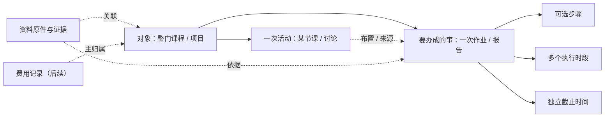

# 对象关联、时间安排与兼容迁移

状态：2026-10-19 设计，2026-10-22 补充本地实现边界。本文为完整目标契约；Desktop 的主归属与集中视图已提供 Beta，当前 objectView 字段及删除行为见[数据格式](../../desktop/DATA_FORMAT.md)。Beta 未修改真实用户 data 或 Web，不等于实现以下所有阶段。

## 当前代码事实

| 已有记录 | 当前入口 | 本轮发现的限制 |
| --- | --- | --- |
| 桌面课表 `tables[].courses[]` | timetable-store / course-import | 一条是某星期、某节次、某周次的一项安排，不等于整门课程对象 |
| 桌面 `plans[]` 与 `tasks[]` | planning.mjs | 已合并列表/编辑器并可选对象归属；仍为两份集合、保留原身份，分类按时间语义 |
| 桌面 calendar | calendar.mjs | 从既有事项与课程课次派生显示，不建立第二套事项/课次库 |
| `webCaptures[]` | web-collector / web-extract | 保留原文、来源、行动草稿，确认才加待办；Beta 可归属对象，没有通用资料库 |
| Web `Block` / `Occurrence` | core schema / data repos | Block 表示时间模板，Occurrence 可重建；没有 Desktop 课程对象仓储 |

原 `Block + Occurrence` 继续解决“何时发生”，不能兼任所有无时间的课程、材料、费用和目的。用户所说的关联要增加组织上下文，不把课程模板复制为待办，也不把记账塞进时间字段。

## 目标关系

关系类型有明确含义。一个记录的主归属只有一个；关联和来源可以有多个。主归属决定默认分组，来源决定证据回溯，相关对象只提供跳转。它们不能混用成没有约束的标签，也不需要先引入图数据库。

## 最小领域契约（提议）

### Object：持续组织内容

`id、type(course/project/general)、title、purpose?、status(active/completed/archived)、createdAt、updatedAt`。

- course 默认持续到学期结束或用户归档，不因某次活动完成而完成。
- 有限项目可以记录预期结果；目标不是所有对象必填项。
- 元数据只保留对象本身的事实；教室、周次留在上课安排，金额留在费用，截止留在事情。

### RecordRef：过渡期的准确定位

`{ collection, id, containerId? }`。collection 可以是 `courseEntry / task / plan / capture` 等；courseEntry 还需要课表 containerId。

旧 task 和 plan 的 id 不假设跨集合唯一，引用必须带集合；不改原 ID，不按标题找记录。对象详情通过服务读取各来源，再形成视图，功能模块不直接互相导入。

### Context：把现有记录关联起来

既有可编辑记录未来增加可选 `context: { primaryObjectId?, relatedObjectIds?, activityRef?, workRef? }`。

- primaryObjectId：这条记录主要属于哪门课/项目。
- relatedObjectIds：跨课程项目的其他关联，不改变主归属或统计金额。
- activityRef：布置作业、产生笔记的具体活动，可缺省。
- workRef：执行安排或资料所服务的事情；必须是类型明确的引用，不能只存一个标题。

context 是归属关系，不是复制出来的课程名称。界面可缓存来源名称作为无法访问/已删除时的说明，不能拿缓存代替有效引用。

### WorkItem：事情、结果和完成状态

已有 task/plan 先保持原记录权威；对象详情只读适配，不立刻合并两份数组。后续统一事项时才能引入一个稳定 workId；保留旧 `{collection,id}` 到新身份的映射，不能只按名称去重。

事情保存期望结果、可选步骤、截止和完成状态。现有 range 的 phases 第一版仍归原计划，不自动展开为另一些待办。完成、取消和恢复都修改原记录；不在对象视图另外存一套 done。

### ExecutionSlot：一件事的多段投入

2026-10-22 已实现的近期基础版将 executionSlots 作为原 task/plan 的可选数组保存，元素为 id/start/end/label?/createdAt/updatedAt；普通非重复事项可使用，截止仍在原 anchor/deadline。今天和日历只读投影，无第二份完成状态、无独立时段集合。以下独立集合、时区/跳过状态与复杂事项契约仍是长期提议，不应当作当前字段。

提议字段：`id、workRef、start、end、timeZone、state(scheduled/skipped)、createdAt、updatedAt`。具体时间段与事情的 dueAt 分离，可有 0～多段；调整一段只改该段，不会新增同名事情或改变截止。

阶段二再实现独立时段集合。旧计划既可能是一件事，也可能是纯时间安排，不能一律自动转换；需要明确的“关联到已有事情 / 作为独立事情”选择。旧全天、固定时段、区间、重复和阶段语义要逐项迁移，有独立回退验证。

## 课程与课次身份

1. 整门课程可以包含多条上课安排，例如高数周一和周三是同一课程的两个排课入口；不能为每张课表卡片创建一个长期课程对象。
2. 有学期、课程代码、教学班号时将它们作为来源身份。当前捕获没有可靠课程代码时，只生成分组候选，让用户确认；同名、同教师或同颜色不足以自动合并。
3. 旧课表条目 id 和所属课表 id 不变，通过映射绑定 courseObjectId。重复抓取用已确认的来源映射，不重建对象和用户关联。
4. 单次活动使用逻辑课次身份：既有排课条目 + 原始教学日期（必要时原始场次）。显示时间、教室和调入日期不参与可变身份。Web 现有可重建 Occurrence.id 不直接承担永久资料归属，需要稳定逻辑身份或显式映射。
5. 调课只改变发生时间，作业仍指向原逻辑活动；停课标记本次活动取消，已有作业不自动取消。删除或重新导入排课时必须处理映射，不能让重建课次清空原关联。

## 页面查询与写入边界

- 对象详情读取“对象本身 + 主归属记录 + 相关引用 + 资料来源”，每条标出所属或相关；同一引用在一个列表去重。
- 今天按工作对象/事情归组，显示今天相关活动、执行时段和将到期的结果。一个事情同日有两段投入时可展开两段，完成按钮仍属于原事情；全局去重不以标题为键。
- 日历投影活动、执行时段、截止为不同类型，点击都能回到上下文。不会因为同一天有截止和执行安排就创建两份事情。
- 归档对象不会隐藏其未完成事项；默认仍在今天/截止清单呈现并标注归档上下文。
- 模块关闭时保留关系；不可用能力给出说明，不主动开启模块或把未来的记账/笔记伪装为已接入。
- 所有编辑调用对应仓储/用例；core 负责纯关联/时间规则，data 负责引用完整性和原子事务，UI 只负责交互。Desktop 暂由现有 Storage/主进程接口适配，不因本设计迁移技术栈。

## 文本与目的：未来资料契约

一份资源记录保存 `id、originalPath/正文、source、capturedAt、checksum?`；整理结果另存 `summary、objectRefs、purposes、evidenceRefs、reviewState`。本地相对路径仍位于同一个 data 内，实际新增目录和格式随实现阶段再定；不把全文附件塞入工作区快照或拷贝成多个原件。

purposes 是“行动要求 / 学习参考 / 验收标准 / 费用凭据 / 过程记录”等用途。它与对象类别相互独立，可多选；未分类和独立资料都合法。摘要、建议与原文分开，手工分类是可用路径，AI 不作为依赖。若未来调用模型，另行取得外发范围的授权。

提取“第 5 次作业周五交”时，先确认来源、课程、结果与截止，再生成事情；正文其他说明保留为证据，不把每句话都拆成待办。日期不明确、关联课程不确定或原文冲突时保留待确认，不能根据文件名或当前日期猜成正式事实。

记账接入后，一笔教材支出是独立交易，主归属通常是课程对象；多个关联只增加查找入口，不重复计入汇总。跨对象分摊需要显式分摊额和总额守恒，不能把一笔钱在每门课下全额相加。

## 删除、迁移与回退

第一步是可选关系，不重写 workspace.json。实现前再决定对象扩展版本，不能把本文示意结构当作已经兼容的 v1 字段。

1. 读取旧文件，建立原始字节备份；默认无关联，不强制推断、移动或删除旧资料。
2. 校验所有主对象、相关对象、活动、workRef 和引用范围；拒绝自归属、循环包含、跨工作区无效引用和悬空主归属。相关引用与层级包含分开校验。
3. 一次关联/取消关联涉及的记录经同一原子提交更新；失败时磁盘、界面和缓存都保持旧快照。
4. 对象有引用时默认归档。永久删除需要明确处理关联：取消关系或转为独立记录，保留业务正文和来源说明；不级联删除作业、凭据或通知。
5. 后续合并 task/plan 时，验证旧 ID 映射、createdAt、日期时分、阶段 ID/完成、每周 completedDates、颜色、来源证据与未知字段全部保留。旧版本是否能读写新备份必须实测；没有验证前不能承诺降级写入无损。
6. 重开、清缓存、复制整个 data、导出/恢复和恢复失败回滚都验证引用。原始资料和关系不放入安装目录外的新散落目录。

## 近期实施切片

| 次序 | 可体验的结果 | 必须通过的例子 |
| --- | --- | --- |
| 1：对象归属 | 在两门课内分别添加作业，从待办回到正确课程 | 同名课区分、双向跳转、独立待办、重复导入、恢复 |
| 2：事情与时间 | 同一作业安排两段时间，今天/日历保持同一结果状态 | 时段不等于截止、交叉周、调课、重复与阶段不丢失 |
| 3：资料归类 | 一份通知关联课程和作业，并按用途查找原文 | 多关联单原件、来源证据、待确认、归档和删除 |
| 4：后续能力 | 真正实现记账/笔记后再接到相同对象 | 金额不重复、来源保留、关闭模块不丢关系 |

以上是完整设计的验收约束；Beta 已覆盖主归属、聚合和原功能跳转，其余不能当作已通过的功能测试。当前实测见[交接说明](../HANDOVER.md)，产品解释见[围绕一件事组织几微](../product/对象与事情设计.md)。
