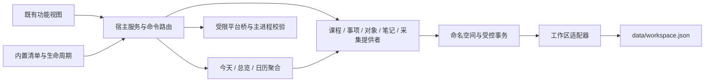

# Desktop 内置插件与服务接口

更新：2026-10-24。本文描述当前本地代码。现有 Desktop 功能已统一接入服务、命令、命名空间和生命周期；Web 保持独立。当前支持笔记关联/提炼、课次来源、普通/阶段/重复执行安排和统一查找；第三方代码加载、沙箱与市场未实现。

## 代码职责

| 文件 | 职责 |
| --- | --- |
| `workbench-host.mjs` | 服务版本、命令、页面和事件注册；失效代理与资源 scope；无正文的注册清单诊断 |
| `plugin-runtime.mjs` | 内置清单、依赖排序/循环检查、激活失败清理、启停与操作代际；可重新安装的监听和定时器 |
| `workbench-services.mjs` | 组合入口：声明内置插件、提供者、依赖、能力和允许的存储键；适配受限平台桥 |
| `plugin-storage.mjs` | 读写键检查、只读映射与显式关联事务权限；事务始终使用完整权威数据回滚 |
| `workspace-service.mjs` | 初始化、开发者模式、示例、设置键、备份恢复和管理能力；恢复先在内存准备，再单次提交 |
| `record-router.mjs` | 按原引用检查提供者，区分状态，再转交所属模块的打开命令 |
| `course-fields.mjs` | 无 DOM 的字段/周次规则，服务、导入与表单共用；旧编辑器导出转发兼容 |
| `platform-permissions.cjs` | 主进程再次检查调用页面、功能开关和操作代际；教务停用释放原窗口/视图 |
| `prototype-modules.js` | 既有界面与壳的装配、渲染和命令处理器；不直接读写业务集合，设置通过受限适配器 |

## 当前 v1 服务

| 服务 / 所属插件 | 主要接口 | 数据边界 |
| --- | --- | --- |
| `workspace`、`records` / workspace | snapshot/revision 读取由工作区适配器提供；restore、developerMode、examples、preferenceStorage；inspect/open 引用 | 管理操作；设置适配器拒绝任务、课程等业务键 |
| `search` / workspace | query({ text?, collection?, objectId? }) 返回 results/total/objects/errors | 只读公开服务，按类型/主归属过滤，最多 80 项，无私有存储回退或正文副本 |
| `courses` / courses | current/list/summary、listEntries/inspect/onDate/occurrences；create/select/remove/update、saveCourse/deleteCourse/batch、adjust/restoreAdjustment、importRows/importCaptured、exportFile | 原 timetables；按课表范围定位，编辑与导入检查当前快照 |
| `items` / items | list/get/inspect/onDate/summary/context/courseContext、save/toggle/setPhase/remove、addFromSource/addFromNote | 原 tasks/plans 身份不变；save 可接收新事项 courseOrigin，核对课次并准备关联后一次提交 |
| `objects` / objects | list/get/read/context/detail/sources/source、save/archive/assign/unassign；事项归属准备桥 | 原 objectView；聚合来源经服务查询 |
| `journal` / notes | list/inspect、start/saveDraft/publish/discardDraft、归档/回收站与草稿接口 | 原 journal；草稿修订、退出拦截与示例守卫保留；context/assign/actions/beginAction/saveActionDraft/confirmAction/discardActionDraft 负责 N2 |
| `web-captures` / web-capture | list/get/inspect/save/approve/collect/openFolder | 原 captures；采集不自动创建事项，确认经 items |
| `course-import` / course-import | open/capture/subscribe | 依赖 courses；手动 WebVPN 登录，返回原文与开始时的课表快照 |
| `calendar` / calendar | preferences/savePreferences/query | 只保存显示偏好；课程和事项经提供者派生，来源失败明确降级 |
| `today` / today | query(date,time) | 查询课程状态及事项；无独立记录集合 |
| `overview` / overview | query() | 各提供者统计与待确认摘要；一个来源失败不隐藏其他来源 |

`workspace.revision()` 是工作区适配器的轻量读取，不需要为每次提交克隆全文；业务成功事件包含 source、revision、sequence、correlationId 和 refs，不广播正文。浏览器隔离测试适配器的 revision 为 0，sequence 在当前运行内递增。事件是重读提示，不能代替持久化，也不保证跨崩溃恰好一次。

## 生命周期与互通

清单包含 id、version、hostApiVersion、requires、servicesRequired、optional、provides 和 capabilities。当前宿主协议版本为 1；清单、依赖循环和必需服务版本在激活时校验。课程导入必需依赖课程，其余聚合来源和对象归属为可选依赖，关闭其中一个仍可使用其他功能。

`host.use()` 获取的旧代理在撤销后永久失效；长期 UI 使用 `host.client()`，每次调用重新解析同版本服务。页面、命令、监听、周期定时器和平台订阅由 owner 管理，停用后撤销，重新开启只安装一份。既有 DOM 可复用，弹窗关闭；笔记 UI 重建前先保存草稿，保存失败拒绝停用。关闭模块的旧表单也不能通过默认提交导航或写入。

引用沿用 `{ collection, id, containerId? }`，课程必须带课表 ID；task/plan 同编号独立，不能用同名记录替代。records.inspect 区分 found、missing、hidden、disabled、unavailable，只有 found 才路由到 courses/items/web-captures/journal 的打开命令；页面不模拟另一功能按钮的点击。对象视图支持取消关联而不删除原记录。

长操作持有插件代际令牌，停用、重启用或工作区恢复后的旧结果不能提交。网页和教务的 UI 忙碌状态也按代际更新，旧回调不能覆盖新请求；主进程对网页原文落盘前再次校验。网络本身保留原有超时，不将忽略旧结果描述为已中止远端请求。

## 数据与兼容

业务提供者仅获得声明的读写键。旧示例事项需要通过 URL/taskId 识别来源；公共兼容适配只暴露示例标记、URL 和任务编号，不向其他提供者暴露采集正文。设置 UI 只有偏好键，插件管理仅有 modules 键。

事项与对象、网页确认与事项、笔记提炼的事项/归属/确认状态均在同一工作区内原子提交。笔记提供者只写 journal，显式获准提交对象关系；items 获准同时提交 journal 确认状态，均不直接读取对方私有键。关联准备必须同步、不写存储，不能覆盖事项集合或返回 Promise；这不是分布式事务。权限检查先覆盖全部键，再开始提交；缓存失败回滚读取完整原文，不使用展示用的只读映射作为备份。

外层 schema、已有 ID、未知字段、旧 tasks/plans 和迁移路径保留。隐藏或停用不删除资料；编辑可见课程时保留隐藏课程及其调整。完整备份与恢复包含关闭模块和未知扩展，登录状态/独立原文仍按既有 data 整体迁移方式保留。未对用户真实资料执行迁移。

所有提供者是仓库维护的可信内置代码。同进程能力声明和存储键限制不等于第三方代码沙箱；当前无安装外部包入口，Web 尚未实现同一运行时。阶段/重复组合已接通具体时段，第三方运行时、自动整组排期与跨端互通仍待后续。

## 验证入口

架构契约见 `desktop/plugin-runtime.test.mjs`，课程和旧模块领域测试继续保留。Electron features 反复启停全部内置模块并检查单一弹窗/单次保存，workspace 使用真实 main/preload 验证写入失败、原记录跳转、直接平台调用拒绝、搬迁与恢复；import-ui、workbench-ui、reset、close 分别覆盖导入、排版、清空重启和退出。具体次数、证据和未验证边界见[交接说明](../HANDOVER.md)。
