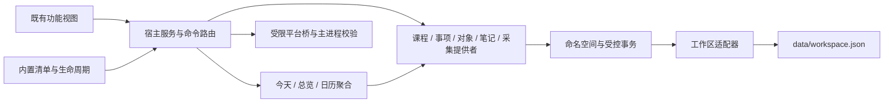

# Desktop 内置插件与服务接口

## 经纬今天呈现修复 · 2026-11-02

提供者today v1不变；消费者loom-render.mjs同步调用query(上海日期,钟点)，一条scheduledItem一张事项纸条，课程由courses.entries另行呈现。监听items/courses/objects的已提交事件重读；syncModules/恢复及切页走原链路，不新建业务事件或存储。renderer只读查询和DOM，完成按钮的数据属性转交原today处理器，完成/撤销均由原items服务及design-experience快照守卫管理；后者只新增可见撤销落点，不复制业务状态。

runtime只转交原编辑/其它待处理事项入口；原today section作为功能宿主保留提醒与原弹层。切骨架恢复DOM，离开今天停renderer定时器、观察器与rAF，workspace停止时统一释放。Ctrl+K不由经纬拦截，原搜索选择可见经纬触发者返回焦点；页面导航改Ctrl+P。

## 经纬导航补充 · 2026-11-02

消费者loom-nav.mjs同步读取模块偏好与host.inventory()的页/命令注册状态：关闭项不渲染，群消息标注挂起；执行前重查，普通页仍由host.navigate守卫，助手调用原assistant.open。syncModules在reconcile完成后同步目录，提醒单独enter/卸载接线，不新建业务事件或改变公共契约。11个原页面和助手对话框可用，挂起功能不因此激活。

骨架运行时beforeShow(id,page)/afterShow在原enter中调用，只负责容器与导航；removePage(page)清除动态节点锚点，防止重开重复。恢复后沿用workspace:changed。search-ui的open(origin?)增加可选DOM触发者，仅供焦点返回，不改变搜索服务参数或结果。监听由workspace bindings停止流程释放，切骨架不重复注册监听。

## 骨架偏好补充 · 2026-11-02

提供者workspace v1，消费者skeleton-runtime.mjs（workspace生命周期）与skeleton-ui.mjs。preferenceStorage([skeletonKey]) 新增许可键 jiwei-desktop-skeleton-v1，内容为 `{schemaVersion:1,skeleton:'workbench'|'loom',loomLayout:'jingwei'|'ripple'|'atlas'|'stage'}` 的JSON字符串，进入既有data.extensions原键，不增加工作区字段。readSkeleton同步只读，缺省/损坏/未来值回落workbench+jingwei；saveSkeleton同步严格校验，写盘成功才返回规范对象、应用外壳，失败抛错并保留旧外壳。恢复后消费既有workspace:changed重读，无新业务事件或OS副作用。枚举是布局注册表，第0期只有经纬预览，不能据此声明四布局完成。

当前不搬移业务节点、不改host.navigate或原命令；第1期再接入页面。设置、返回及键盘监听归workspace bindings，停止时释放；未新增在途异步资源。

## 工作区外观偏好补充 · 2026-10-31

提供者仍为workspace v1，消费者为desktop-design.mjs（workspace生命周期）与设置页；preferenceStorage 新增许可键 jiwei-desktop-layout-v1，数据规范见 desktop/DATA_FORMAT.md 的布局偏好。readLayout 为同步只读；saveLayout 同步校验并交给已有工作区持久化适配器，成功返回规范值。布局、粒子与位置保存独立于颜色保存，不改课程/事项等集合；写盘失败抛错，界面恢复上次已提交状态，拖动中只调整显示，结束才保存。没有新增事件、业务服务或原生副作用。

外观壳复用原导航DOM与插件按钮，监听由workspace bindings拥有；观察器、在途拖动及动画帧在onStop释放，布局回调带代际/销毁守卫。全局按钮仅转交原查找、助手和设置入口，助手停用隐藏对应入口，重开不复制按钮。没有扩展通用异步卸载协议。

更新：2026-10-30。本文描述当前本地代码。现有 Desktop 功能已统一接入服务、命令、命名空间和生命周期；Web 保持独立。当前支持笔记关联/提炼、课次来源、普通/阶段/重复执行安排和统一查找；第三方代码加载、沙箱与市场未实现。

## 代码职责

| 文件 | 职责 |
| --- | --- |
| `workbench-host.mjs` | 服务版本、命令、页面和事件注册；失效代理与资源 scope；无正文的注册清单诊断 |
| `plugin-runtime.mjs` | 内置清单、依赖排序/循环检查、激活失败清理、启停与操作代际；可重新安装的监听和定时器 |
| `workbench-services.mjs` | 组合入口：声明内置插件、提供者、依赖、能力和允许的存储键；适配受限平台桥 |
| `plugin-storage.mjs` | 读写键检查、只读映射与显式关联事务权限；事务始终使用完整权威数据回滚 |
| `workspace-service.mjs` | 初始化、开发者模式、示例、设置键、备份恢复和管理能力；恢复先在内存准备，再单次提交 |
| `record-router.mjs` | 按原引用检查提供者，区分状态，再转交所属模块的打开命令 |
| `course-fields.mjs` | 无 DOM 的字段/周次规则，服务、导入与表单共用；旧编辑器导出转发兼容 |
| `platform-permissions.cjs` | 主进程再次检查调用页面、功能开关和操作代际；教务停用释放原窗口/视图 |
| `prototype-modules.js` | 既有界面与壳的装配、渲染和命令处理器；不直接读写业务集合，设置通过受限适配器 |

## 当前 v1 服务

| 服务 / 所属插件 | 主要接口 | 数据边界 |
| --- | --- | --- |
| `workspace`、`records` / workspace | snapshot/revision 读取由工作区适配器提供；restore、developerMode、examples、preferenceStorage；inspect/open 引用 | 管理操作；设置适配器拒绝任务、课程等业务键 |
| `search` / workspace | query({ text?, collection?, objectId? }) 返回 results/total/objects/errors | 只读公开服务，按类型/主归属过滤，最多 80 项，无私有存储回退或正文副本 |
| `courses` / courses | current/list/summary、listEntries/inspect/onDate/occurrences；create/select/remove/update、saveCourse/deleteCourse/batch、adjust/restoreAdjustment、importRows/importCaptured、exportFile | 原 timetables；按课表范围定位，编辑与导入检查当前快照 |
| `items` / items | list/get/inspect/onDate/summary/context/courseContext、save/toggle/setPhase/remove、addFromSource/addFromNote | 原 tasks/plans 身份不变；save 可接收新事项 courseOrigin，核对课次并准备关联后一次提交 |
| `objects` / objects | list/get/read/context/detail/sources/source、save/archive/assign/unassign；事项归属准备桥 | 原 objectView；聚合来源经服务查询 |
| `journal` / notes | list/inspect、start/saveDraft/publish/discardDraft、归档/回收站与草稿接口 | 原 journal；草稿修订、退出拦截与示例守卫保留；context/assign/actions/beginAction/saveActionDraft/confirmAction/discardActionDraft 负责 N2 |
| `web-captures` / web-capture | list/get/inspect/save/approve/collect/openFolder | 原 captures；采集不自动创建事项，确认经 items |
| `course-import` / course-import | open/capture/subscribe | 依赖 courses；手动 WebVPN 登录，返回原文与开始时的课表快照 |
| `calendar` / calendar | preferences/savePreferences/query | 只保存显示偏好；课程和事项经提供者派生，来源失败明确降级 |
| `today` / today | query(date,time) | 查询课程状态及事项；无独立记录集合 |
| `overview` / overview | query() | 各提供者统计与待确认摘要；一个来源失败不隐藏其他来源 |

`workspace.revision()` 是工作区适配器的轻量读取，不需要为每次提交克隆全文；业务成功事件包含 source、revision、sequence、correlationId 和 refs，不广播正文。浏览器隔离测试适配器的 revision 为 0，sequence 在当前运行内递增。事件是重读提示，不能代替持久化，也不保证跨崩溃恰好一次。

## 生命周期与互通

清单包含 id、version、hostApiVersion、requires、servicesRequired、optional、provides 和 capabilities。当前宿主协议版本为 1；清单、依赖循环和必需服务版本在激活时校验。课程导入必需依赖课程，其余聚合来源和对象归属为可选依赖，关闭其中一个仍可使用其他功能。

`host.use()` 获取的旧代理在撤销后永久失效；长期 UI 使用 `host.client()`，每次调用重新解析同版本服务。页面、命令、监听、周期定时器和平台订阅由 owner 管理，停用后撤销，重新开启只安装一份。既有 DOM 可复用，弹窗关闭；笔记 UI 重建前先保存草稿，保存失败拒绝停用。关闭模块的旧表单也不能通过默认提交导航或写入。

引用沿用 `{ collection, id, containerId? }`，课程必须带课表 ID；task/plan 同编号独立，不能用同名记录替代。records.inspect 区分 found、missing、hidden、disabled、unavailable，只有 found 才路由到 courses/items/web-captures/journal 的打开命令；页面不模拟另一功能按钮的点击。对象视图支持取消关联而不删除原记录。

长操作持有插件代际令牌，停用、重启用或工作区恢复后的旧结果不能提交。网页和教务的 UI 忙碌状态也按代际更新，旧回调不能覆盖新请求；主进程对网页原文落盘前再次校验。网络本身保留原有超时，不将忽略旧结果描述为已中止远端请求。

## 数据与兼容

业务提供者仅获得声明的读写键。旧示例事项需要通过 URL/taskId 识别来源；公共兼容适配只暴露示例标记、URL 和任务编号，不向其他提供者暴露采集正文。设置 UI 只有偏好键，插件管理仅有 modules 键。

事项与对象、网页确认与事项、笔记提炼的事项/归属/确认状态均在同一工作区内原子提交。笔记提供者只写 journal，显式获准提交对象关系；items 获准同时提交 journal 确认状态，均不直接读取对方私有键。关联准备必须同步、不写存储，不能覆盖事项集合或返回 Promise；这不是分布式事务。权限检查先覆盖全部键，再开始提交；缓存失败回滚读取完整原文，不使用展示用的只读映射作为备份。

外层 schema、已有 ID、未知字段、旧 tasks/plans 和迁移路径保留。隐藏或停用不删除资料；编辑可见课程时保留隐藏课程及其调整。完整备份与恢复包含关闭模块和未知扩展，登录状态/独立原文仍按既有 data 整体迁移方式保留。未对用户真实资料执行迁移。

所有提供者是仓库维护的可信内置代码。同进程能力声明和存储键限制不等于第三方代码沙箱；当前无安装外部包入口，Web 尚未实现同一运行时。阶段/重复组合已接通具体时段，第三方运行时、自动整组排期与跨端互通仍待后续。

## 验证入口

架构契约见 `desktop/plugin-runtime.test.mjs`，课程和旧模块领域测试继续保留。Electron features 反复启停全部内置模块并检查单一弹窗/单次保存，workspace 使用真实 main/preload 验证写入失败、原记录跳转、直接平台调用拒绝、搬迁与恢复；import-ui、workbench-ui、reset、close 分别覆盖导入、排版、清空重启和退出。具体次数、证据和未验证边界见[交接说明](../HANDOVER.md)。

## reminders v1 · 提醒公共契约（2026-10-30）

提供者：reminders内置插件（desktop/reminder-plugin.mjs），服务版本1；必需workspace v1，不依赖assistant。消费者是提醒页面、今天提醒区、AI助手和公共命令调用者。所有业务方法返回Promise；request仅允许下表五种平台动作，其他动作拒绝。

| 服务方法 / 公共命令 | 参数 | 成功结果 | 写入与副作用 |
| --- | --- | --- | --- |
| list / reminders.list | 无 | {ok:true,rows} | 只读提醒记录及投递回执，不创建任务 |
| add / reminders.add | {title,mode?,at?,date?,daily?} | {ok:true,row}，row.id为真实新编号 | 校验后保存新记录，timed再注册系统任务；注册失败回滚新增记录 |
| cancel / reminders.cancel | id字符串 | {ok:true} | timed先取消系统任务，成功后删除记录/回执；取消失败保留记录 |
| state / reminders.state | id字符串、archived布尔 | {ok:true} | silent/attention处理或恢复；timed拒绝，需用cancel |
| repair / reminders.repair | 无 | {ok:true,count} | 逐项重注册未来单次及每日定时提醒，跳过归档/静默/长期/过期单次；中途失败抛错，不保证整组回滚 |

对应request动作为reminders-list、reminder-add、reminder-cancel、reminder-state、reminder-repair。公共命令使用表中参数形式；request使用对应对象负载，如取消为{id}、归档为{id,archived}。

### 数据、参数与错误

- title去除两端空白后1–160字符；mode默认timed，可选silent、attention。timed的at为未来一年内的毫秒时间戳，daily可选布尔；silent的date为今天或未来一年内的YYYY-MM-DD；attention持续显示，无定时时刻。
- row包含id、title、mode、at、daily、archived及可选date/taskName；list补充lastFired、delivered投递字段。工作区格式不变，Windows记录仍在data/reminders.json，回执在reminder-receipts；当前桌面源码的v2 .jiwei包含可迁移字段和投递状态，剔除taskName并按目标路径重建；旧v1包不含提醒、导入时保留本机记录。整体替换与回滚边界见[数据格式](../../desktop/DATA_FORMAT.md#提醒迁移2026-10-30本地桌面源码)。
- 服务不可用/错版时由宿主拒绝；关闭服务后命令撤销；参数和时间错误由提醒规则/平台校验。平台{ok:false,message}转换成Error，不返回伪空列表或成功。主进程继续检查本地页面、开关与操作代际。
- 每次服务请求持有runtime.ticket，关闭或重新载入后，旧回包拒绝且不发送reminders:committed。成功写操作才发送该事件；观察者异常不回滚已提交的资料。
- 原生平台串行处理写操作和启停。排队写入开始前再查开关；已开始操作可能先完成持久化，随后关闭队列取消系统任务。迟到回包被拒绝不等于原操作从未落盘，重试前应刷新核对；add目前没有客户端幂等键。
- Windows系统命令复用20秒超时的原辅助进程。不是所有Promise都具有通用可取消协议；测试替代适配器也应遵守有界完成约定。

### 关闭、恢复与失败收敛

关闭保留全部提醒记录，串行取消定时任务；静默/长期不创建系统任务。重新开启只恢复未来单次及每日任务，保留原编号/任务名。每次reconcile捕获本次目标开关，快速关闭/重开按队列依次处理；后续恢复使用原任务名，不创建第二份业务提醒。

部分取消或恢复失败时，同步标记appliedEnabled重置为null，保留错误，下一次reconcile可以重试；不能保留旧的“已同步”标记而跳过恢复。业务开关保存完成不等于系统取消已经完成。提醒worker仍在投递前读取持久化开关。

### 开发者只读诊断

runtime.list新增expected、status、missingDependencies、requiredServices、providedServices、resourceCounts及lastError，原active/resources字段保留。status区分running、disabled、blocked、error、waiting、stopped；最近错误记录运行时捕获的激活/效果清理失败，不代表捕获全部业务错误。资源只统计宿主可见的效果、服务、命令和作用域。

host.inventory原契约保持；新增host.resourceInventory只返回命令owner与scope owner元信息，不含业务正文。插件管理中的诊断面板仅在开发者模式显示，普通模式清空并收起。当前先在桌面开放，未移植手机。

额外的原生动作reminder-diagnostics只用于诊断，不属于reminders v1业务命令。通过既有受限桥请求，主进程同时校验本地页面和developerMode；即使提醒已关闭仍可读其暂停状态。结果是{ok:true,desiredEnabled,appliedEnabled,pending,running,lastError}，不返回提醒内容、密钥或任务列表，不读写提醒资料或扫描系统任务计划。

appliedEnabled表示最近一次完整同步请求的结果，null表示未知或同步失败；pending包括运行及排队请求。最近错误保留作历史，即使恢复成功也可能仍显示。界面明确区分开关期望、插件运行与原生同步，不把这些状态当作逐项系统任务验收。

本轮没有引入通用异步scope.dispose、持久Agent流程或第三方沙箱。原子保存业务文件与系统任务操作也不是跨系统原子事务。

### 2026-10-30 · 主进程提醒迁移适配

workspace-transfer消费reminder-platform的内部snapshot/transfer适配；它们不是新增的reminders公共业务命令，UI/AI仍使用现有v1服务。snapshot只输出校验后的可迁移字段，transfer进入与提醒写入/reconcile相同队列；主进程迁移期间拒绝新业务写入、重置和其他提醒操作。迁移检查、备份、恢复日志、业务提交与系统注册分开：业务提交前失败回滚文件并尝试恢复原任务，提交后系统注册失败返回warnings和backup，不重复业务导入。恢复日志未清理时继续禁止写入直至重启处理。

备份与预览读取不改变资料；导出遇提醒排队则要求稍后重试。含提醒的提交为异步，UI必须等待结果，并保留系统警告及备份位置；appliedEnabled仍只表示适配器同步结果，不代替操作系统逐项审计。旧包缺少提醒不会发起提醒替换，工作区开关恢复仍按现有reconcile生效。

### 2026-10-30 · 对象记录与今天推进

notes.capture({objectId?})经journal.start(undefined,{objectId})建立关联笔记草稿；对象归属仅在草稿pendingObjectId中暂存，草稿正文自动保存。journal.draftContext()只查询草稿归属及可见对象；publish成功时笔记和对象引用同次事务提交，失败保留草稿，关闭对象功能时禁止带归属发布。已有草稿优先继续并明确提示，不接管其归属。编辑原笔记不改变原关联，字段仍为schemaVersion 1可选扩展。

今天页完成操作继续调用items.toggle(ref,原定日期)，不引入第二套完成状态。普通事项完成整条；重复事项只完成某次，改期执行仍按occurrenceDate，多个原定日期分别展示；未排在今天的重复事项不提供完成今天按钮。点击前重查原事项及完成日期，失败保留原视图并反馈；成功刷新今天、事项、对象和日历。

### 2026-10-30 · 同一课程跨课次的事项查询

items v1新增同步只读forCourse(courseRef,{originalDate?,date?})，供课程编辑消费。courseRef必须是含containerId的courseEntry引用；重查courses提供者及原身份，关闭、隐藏、缺失、不可用时抛错，界面只在事项区域显示不可用，不阻止编辑课程。返回current（指定原课次全部事项）、other（其他原课次尚未结束的事项）、completedCount与total；没有originalDate时other包含本课程全部未结束事项。date用于排序，均不写入状态或修改完成时间。

查询按courseOrigin的tableId/courseId/originalDate匹配，不按标题归并，任务和计划同编号仍分开。当前课次保留已完成项，其他课次只收未done的普通事项；重复事项保留为“重复安排”，本次完成不等于整组结束。UI默认收起其他课次，打开前重查原事项的课程身份，沿用items.edit/原课次返回及现有保存事务；不新建课程专用任务集合。

### 2026-10-30 · 快速安排执行时间

items v1增加schedule(ref,slot,{expected})，只在原事项executionSlots追加一段，保留截止、阶段、来源、完成及归属。expected为打开时items.get的完整JSON快照，提交重查来源可见性与最新快照；冲突拒绝覆盖。slot只接id/label/start/end/phaseId?/occurrenceDate?，按现有validateItem校验范围及重复规则，已完成事项/阶段/原定重复次数拒绝追加。相同id与内容的重试幂等，不重复创建；同id异内容、重复时间段或超过100段拒绝。原子业务提交成功才通知，磁盘失败保留原盘与表单。

items.schedule命令打开现有事项插件的独立小表单，保持今天页；今天卡片展开后提供安排时间。保存只追加时段，经原查询进入对应日期的今天与日历；取消不写盘。表单与事项同一启停范围，切页/停用关闭，不额外建立提醒或后台任务，数据格式不变。
## 对象与日历原位打开补充 · 2026-11-09

提供者仍为 items / objects 的现有 UI 命令；消费者为对象全貌、事项编辑器与日历。命令参数、返回值、业务版本和数据格式不变：`items.edit(kind,id,date,type,objectId,origin)` 编辑已有事项且当前页为日历时保留日历页，只打开共享事项编辑弹层；新建及其他页面沿用事项页入口。关闭、取消及保存成功后留在原日历视图和游标，保存继续调用 items.save，成功提交后才刷新；失败保留表单。切页或停用沿用事项生命周期关闭编辑器，不新增监听、异步资源或存储。

`objects.open(id)` 同步核对对象存在后导航：工作台选择原详情，经纬调用现有 openIn 显示对象全貌，避免写进隐藏旧页。来源按钮仅查询和导航，不隐式保存编辑器未提交的修改。对象关闭或不可用沿用原错误路径，不创建替代对象。

## 阶段①②收尾：对象范围与提醒编辑 · 2026-11-09

calendar v1 的 `query(range,filters,{objectId?:string}={})` 增加可选对象范围；前两参数和无范围行为兼容。消费者为工作台与经纬日历，提供者只通过 objects.detail、items.list、课程投影读取原记录，不访问其他插件私有存储。按 collection/id 匹配事项，按 tableId/courseId 匹配课程，可投影关联的多个课表；无日期事项保留在 floating。返回可选 object 摘要和既有 errors。对象关闭/不存在时拒绝该范围查询，UI 显示原因和「返回全部日历」，不悄悄展示全部资料；部分关联来源失效时保留其他可用内容并报告原因。

UI 命令 `calendar.object(id,view='week')` 同步核对对象与 day/week/month，再导航和设置呈现范围。范围只存在于当前呈现层内存，不写业务记录或日历偏好；视图种类继续沿用原偏好保存。跨骨架不承诺传递临时范围。对象全貌调用该命令；课程记录的「查看所在课表」复用 courses.select 后导航，不修改课程模板或调整记录。

reminders v1 新增 `update({id,expected,title,mode,at?,date?,daily?})`，对应平台 `reminder-update`；UI 命令 `reminders.edit(id)` 打开现有表单。expected 为 reminderRevision 的可编辑字段签名，排除异步投递回执；编辑保留原 ID、任务名、未知字段、类型与投递历史，类型切换需另建。已处理、被移除、过期快照或非法时间拒绝修改。该操作只写 reminders.json，不读取或改写事项截止、执行安排与对象归属。

更新与启停/迁移仍串行执行：先验证并原子保存新提醒行，定时提醒替换同一系统任务；注册失败恢复原行并尝试恢复原系统注册，恢复系统任务也失败则返回明确修复提示并将 applied 状态置为未知。静默和长期注意不调用系统调度器。成功返回后才发 reminders:committed。提醒表单阻止重复提交，失败保留输入；关闭/重开带编辑代际守卫，旧结果不关闭新编辑器，插件停止沿用 ticket 守卫及计时器/观察器清理。数据格式和备份 schema 不变，回执不因编辑被删除，每日投递历史保留以防重复。
