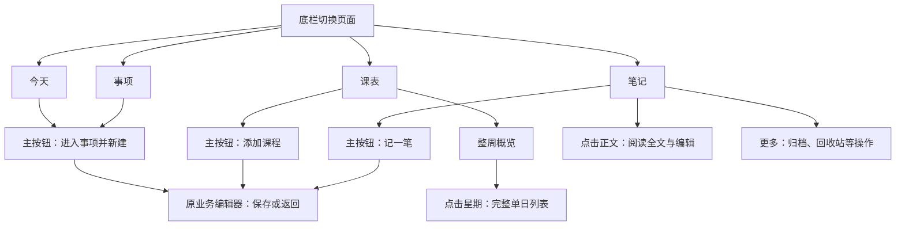

# 几微 Android Beta

Android 使用 Java Activity + 系统 WebView，复用 Desktop 的可信内置插件、HTML/CSS/ES Modules 与工作区模型；不需要电脑开服务器或 Google 服务。Web/React 仍是独立客户端。本地 Beta 参考 [DeepSeek 手机界面观察](../docs/research/DeepSeek界面与交互观察.md)，当前包为 `mobile/release/JeeWeave-0.3.0-mobile-beta.3.apk`，同目录有 SHA-256。

## 最简单的本地体验（无需模拟器）

1. 双击 [启动手机预览.cmd](启动手机预览.cmd)。当前电脑已具备依赖；以后换电脑需先安装 Node.js 22+ 并在项目根目录执行 pnpm install。
2. 自动打开手机尺寸窗口。首次可从“目录 → 设置”打开开发者模式，再导入示例；页面上的下载箭头就是示例导入。正常模式不会出现示例按钮。
3. 手机与电脑连接同一 Wi-Fi，在手机浏览器输入启动窗口显示的地址（例如 http://192.168.1.10:4175/）。不要在手机上输入127.0.0.1，它代表手机自身。
4. 关闭手机尺寸窗口，预览服务也随之停止。再次双击可继续体验；改代码后关闭重开以更新生成资源。

只在电脑体验可直接使用自动打开的窗口。手机地址打不开时，检查手机/电脑是否在同一局域网；Windows若询问Node网络访问，按需允许当前私人网络，别关闭整个防火墙。校园/访客Wi-Fi可能禁止设备互访，可以让电脑连接手机热点后重试。启动窗口会显示当前地址，换网络后应关闭重开。

这是同一套手机UI的浏览器预览：可体验课程、事项、日历、笔记、对象、主题与本地保存；电脑和手机各存一份预览资料，不自动同步，不读取 desktop/data，也不能用来验证 Android 教务登录、系统文件窗口、系统返回或后台行为。浏览器预览的导入导出仍会明确提示需APK；清除浏览器站点数据会删除预览记录。当前无需安装Android工具、启用USB调试或修改系统虚拟化。

预览只提供 mobile/dist 中的生成资源，无工作区读取/上传接口。需要单独保留服务而不打开电脑窗口时，可运行 node mobile/preview.mjs --server-only，按Ctrl+C停止。端口默认4175；端口占用会提示，不自动换地址以免把旧预览数据误认为丢失。

## 安装与兼容

将 APK 传到手机，用文件管理器打开，按系统提示允许此次安装。需要 Android 8/API26 以上和 WebView/Chrome108 以上；过旧引擎会提示更新。纯鸿蒙 HarmonyOS NEXT 不支持 APK。覆盖更新保留资料；卸载前请导出迁移包，卸载会删除应用私有资料。

这是本机 Beta 签名包，未上架、未上传 GitHub。beta.3 包含10月27日手机UI精简与WebVPN修正，构建及包内资源已检查；真机安装、键盘、返回、文件窗口及真实学校登录尚未验收，不能把电脑预览当作 Android 实测。

2026-10-28 按用户要求生成 beta.3 APK，包含此前仅在源码/预览中的 UI 与 WebVPN 修正。10 月 25 日生成的“几微验证”已随测试缓存清理移除；release 包仍保留且未覆盖。模拟器工具已在本机缓存，先按 [模拟器启动说明](guides/模拟器启动.md) 开启 Windows 硬件加速，再双击 [启动模拟器.cmd](启动模拟器.cmd)。

手机界面：课程默认整周概览，无需横向拖动，点星期打开单日课程列表，空白节次不再占满日视图；左右滑动切周/日期，按钮也可完成同一操作。新增使用右下角图标，跳周保留在“更多”，设置内保留导入、批量编辑和作息。事项点正文编辑，删除仍在编辑器；笔记归档/回收站及对象低频操作集中收起。各页增加边距，编辑器固定标题和保存操作、正文单独滚动；次要字段可展开。电脑 320/390/900 像素和短屏交互已检查，Android 系统实际表现待验。

## 当前能力

| 功能 | Android 实现 |
| --- | --- |
| 常用入口 | 底部“今天 / 课表 / 事项 / 笔记”切换页面，独立主按钮负责新增；侧滑目录提供其余功能；开关关闭后相应入口收起 |
| 课程、事项、日历、笔记、对象、查找 | 共用桌面业务与稳定 ID；手机编辑全屏，宽屏保留侧栏 |
| 教务抓取 | 应用内独立登录 WebView；手动登录 WebVPN、查询课表，点击顶部“抓取课表”读取并导入；调试模式显示原始文本 |
| 数据迁移 | 桌面同格式 .jiwei 包，含附件；JSON 工作区兼容，预览与确认替换，导入前保留工作区 |
| 课程 / 笔记导出 | CSV、ICS、Markdown 使用系统保存窗口 |
| 公开网页在线抓取 | 仍未移植；可查看和整理已迁入的网页资料 |
| 群消息、记账、外部 AI、第三方插件、同步、原生提醒 | 保持暂停或未实现状态 |

## 手机操作关系

参考 [Tasks.org](https://github.com/tasks/tasks) 的清单组织和 [Notesnook](https://github.com/streetwriters/notesnook/blob/master/docs/help/contents/export-notes-from-notesnook.md) 的笔记操作菜单，沿用几微的配色、SVG与原业务编辑器，不引入它们的源码或依赖。用 Mermaid 记录导航与创建的关系；界面适配由 Impeccable 流程和 ui-ux-pro-max 图标可访问性建议辅助。



新增使用“＋”，笔记使用书写图标；均保留可访问名称和悬停提示。页面说明及设置解释在信息图标后展开，错误与操作结果照常显示。主按钮在编辑器、目录抽屉或软键盘打开时收起；关闭模块会隐藏相应入口。手机顶栏重复的新增按钮收起，宽屏仍用原页面操作。整周保留名称与教室概览，单日显示教师、周次和节次；两种模式都有图标与短标签。笔记正文支持点击与键盘进入编辑，归档/回收站仍保留独立入口。电脑隔离预览通过不代表 Android 真机验收。

## 数据与双向迁移

资料在应用私有 `files/data/workspace.json`；原文在同一 data 下的 captures。保存成功才更新界面，保留 workspace.previous.json，导入前另存备份。没有直接打开私有文件夹或开发者清空入口。

电脑 → 手机：桌面“设置 → 数据迁移与备份”导出 .jiwei，传到手机后选择导入，核对版本与数量，再确认替换。手机 → 电脑：手机同一设置导出 .jiwei，再由兼容桌面版本导入。附件逐项核对安全路径、Base64、SHA-256、大小及重复项，先写独立目录，业务提交失败撤回新附件，已有资料不改。兼容包版本1 / 工作区版本1；未知新版明确拒绝。附件上限64 MiB/10000个，迁移包128 MiB，工作区32 MiB。登录 Cookie 和接入密钥不迁移；不会自动同步。

旧0.3.0不支持新增的复杂阶段/重复执行组合，降级先保留原工作区。JSON不包含独立原文，需要附件时用 .jiwei。原始附件随备份保留，不因迁入另一台设备而删除源文件。

## 教务登录隔离

“课程表 → 设置 → 导入导出 → 打开 WebVPN 登录”。默认南邮 VPN 首页 `https://vpn.njupt.edu.cn:8443/`，登录后自行选择教务系统；旧固定 user-login 深层入口在 2026-10-26 无 Cookie 请求中返回404，首页返回200。原生加载区分主页面HTTP错误和子资源错误，保留失败提示，“更多 → VPN 首页”可重新进入；可手动尝试电脑版网页，不默认伪装设备。登录、验证码由用户完成，查询学生课表后用顶部按钮抓取；弹出的学校页面仍在同一应用内承载，返回几微保留当前登录页。读取仍使用原解析器处理合并节次、单双周与待安排课程。完整真实账号链路待用户验收，首页200不代表教务登录已验证。

学校页面没有 JeeWeaveNative 接口，不能访问本地工作区；只允许 HTTPS 网页，证书错误不绕过。主工作区仍只加载包内资产，CSP 拒绝远程脚本、iframe 和网络请求。APK 新增正常 Internet 权限供独立登录页联网，不申请通讯录、账号或广泛文件权限。Android 没有 Electron 的隔离世界/跨源 frame 接口；实际学校页面兼容性仍需手动验收，不能因模拟样例通过就宣称学校账号链路已通过。

## 开发与检查

```powershell
# 官方 JDK21 / SDK35，仅放项目缓存，不改 PATH
pwsh -NoProfile -File mobile/setup-tools.ps1
# 可选 adb、模拟器与 Android15 镜像，下载约1.3GB
pwsh -NoProfile -File mobile/setup-tools.ps1 -AndroidTests
# 当前应用 APK
pwsh -NoProfile -File mobile/build.ps1
# 独立“几微验证”副本，不覆盖用户应用或资料
pwsh -NoProfile -File mobile/build.ps1 -TestBed
# JS 与附件原生逻辑、双向迁移
node mobile/prepare.mjs
node --test mobile/bridge.test.mjs
pwsh -NoProfile -File mobile/native-files-test.ps1 -WithDesktopRoundtrip
node mobile/test-ui.mjs
# 只编译原生测试 APK，不接触手机
pwsh -NoProfile -File mobile/android-test.ps1 -BuildOnly -Physical
# 得到用户明确授权且设备已调试连接后，传入 adb 实际显示的设备编号
pwsh -NoProfile -File mobile/android-test.ps1 -Physical -Serial <设备编号>
```

构建使用 javac/D8/AAPT2/zipalign/apksigner，无额外生产框架；打包前规范化 Windows AAPT2 资产分隔符，签名后逐文件比对。测试专用 org.json20250517 从 Maven Central 下载到忽略缓存并校验，不加入正式 APK；附件逻辑在 JVM 的实际文件上验证，不能代替 Android Activity 实测。原生测试另成 APK，正式包不含测试类或测试入口。默认测试脚本只允许专用模拟器；物理设备使用 -Physical 时只安装/清空 cn.jeeweave.mobile.testbed，不清空用户主应用。

`mobile/.signing/jeeweave-beta.jks` 是本机 Beta 身份，默认测试口令 android，Git 忽略；保留它才能覆盖更新。正式发行密钥另行管理。构建支持 -JavaHome/-SdkRoot；工具缓存与测试资料均在 mobile/.cache，Windows adb 默认还会使用用户 .android 配置目录。未自动开启虚拟化功能或安装系统驱动。

测试清理：UI检查与原生附件/双向迁移检查均在专用临时目录运行，成功或失败后删除本轮数据、profile、截图及附件样例。打包编译目录也在结束后删除；APK、SHA-256、摘要日志、签名密钥、工具与手动预览资料保留。覆盖更新请直接安装beta.3，不先卸载；包名与Beta签名保持一致，versionCode升为3。手机真实安装与学校账号链路仍待体验。

## 智能输入与提醒（10月29日源码，beta.3不含）

顶栏星形按钮打开统一输入。文字可直接输入；麦克风调用Android系统语音识别（设备需要有识别服务，服务本身可能联网）；图片通过系统选择器选取，压缩到最长边不超过1024px、JPEG75后才发送。可移除图片，再次确认要发的内容。模拟器/真实手机输入能力尚未验收，电脑预览不提供系统语音或API联网。

在面板的API设置中填写DeepSeek文本密钥、模型；图片需另填支持OpenAI兼容chat/completions及image_url的视觉地址、模型和密钥。默认DeepSeek文本模型按本次官方文档为deepseek-flash，可自行改名。密钥用Android Keystore AES-GCM加密，不写进工作区、不随备份迁移。语音结果会先填回输入框；点击分析才发送当前文本/图片，整个工作区和历史记录不会发送。单次输出上限512token；实际费用按服务商统计，并显示本次用量，不能保证每次固定消耗。简单“10分钟后提醒我取快递”等格式直接本地识别，0模型token。

当前支持新增事项、同日明确时间段的事件、保存笔记、打开指定页面和单次/每日提醒；先预览再确认执行，不开放任意函数、代码或删除操作。含糊指令会追问；笔记存在草稿时拒绝覆盖。事项与笔记通过原插件服务保存，关闭模块的守卫继续生效。

提醒可直接在面板表单配置而不调用API。短时提醒需要Android通知/准点权限；每日提醒没有准点权限时可能延后。支持取消、重启及升级后恢复，跨时区按本地钟点恢复每日提醒。Android强制停止、通知关闭和厂商省电会影响投递，不能承诺必达。提醒存在私有data/reminders.json，暂不进入.jiwei工作区迁移，换手机需重新安排；API配置也需重新填写。未自动申请麦克风/照片库广泛权限，未接入任何群消息。
