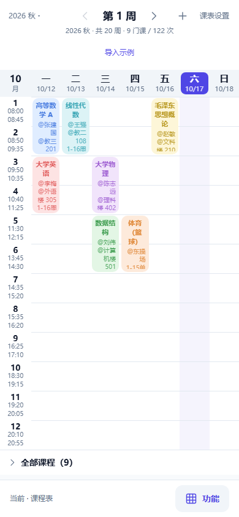
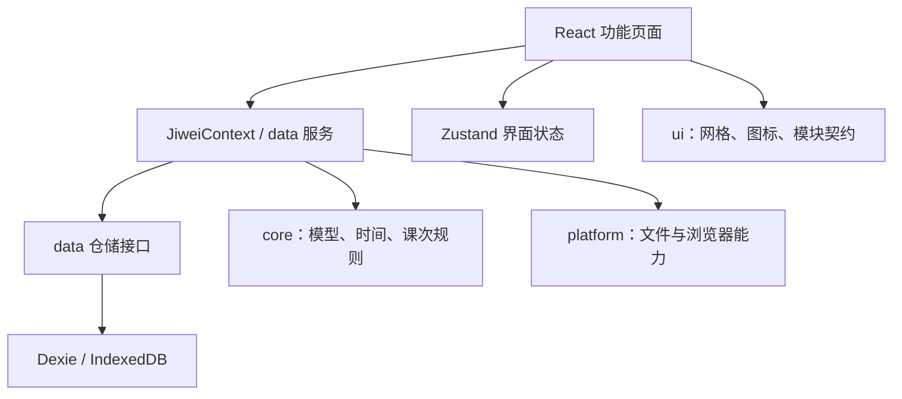

# 几微 Web

浏览器中的课程表与今天工作台，可作为 PWA 添加到主屏幕。在线入口：[arrsk.github.io/jiwei](https://arrsk.github.io/jiwei/)。



*截图使用隔离测试中的虚构数据。源码于 2026-10-17 按 GitHub main 的 `d0ef898` 恢复，保留现有目录结构所需的路径适配。*

## 已实现

- 多课表新建、切换、改名和删除；周/日视图、教学周切换、课程增删改及批量编辑。
- 单双周、跳周、连堂和逐学期作息；单次调课、停课与恢复。
- 今天首页、计划、待办及功能模块开关。
- CSV/ICS 课程文件导入预览、确认与导出；JSON 数据备份/恢复。
- 系统明暗主题、PWA 资源缓存与安装说明、存储保护提示和示例导入。

网页版没有桌面教务窗口/IPC 或实时登录课表抓取；记账、笔记、AI 等占位入口仍属规划。PWA 安装不等于已有 APK 或系统级闹钟。

## 技术框架

| 部分 | 当前依赖/职责 |
| --- | --- |
| 界面 | React 19、TypeScript 5.9 |
| 开发与构建 | Vite 7、Tailwind CSS 4 |
| 界面状态 | Zustand 5：当前模块、学期、周次、日视图及提示 |
| 本地数据 | IndexedDB / Dexie 4，经 `useJiwei().repos` 与 data 服务访问 |
| 数据契约 | Zod 4，公共模型与校验 |
| 日期与课次 | `shared/packages/core`：模板、派生课次、调整与日期规则 |
| 公共界面 | `shared/packages/ui`：网格、图标和模块契约 |
| 平台适配 | `shared/packages/platform`：当前 Web 实现 |
| 离线资源 | vite-plugin-pwa / Workbox |
| 验证 | Vitest 3、构建 smoke、隔离浏览器交互测试 |

精确版本以根目录 `pnpm-lock.yaml` 为准。



课程模板 `Block` 与实际课次 `Occurrence` 分离；调课/停课属于特定课次的调整。学期、课程、作息或调整变更后，由数据服务按需重建课次并调用刷新信号，界面不直接管理 Dexie 表。

## 本地开发

在仓库根目录安装 Node.js 22.12+ 和指定版本 pnpm 11.8.0，再执行：

```sh
pnpm install --frozen-lockfile
pnpm dev
```

默认开发地址：`http://127.0.0.1:5273/`。Windows 可双击本目录 `启动开发服务器.cmd`，脚本直接调用已安装的 Vite 并等待服务就绪。

```sh
pnpm typecheck
pnpm test
pnpm build
pnpm smoke
pnpm preview
```

`pnpm test` 覆盖公共层和 Web 单测，桌面单测另跑 `pnpm desktop:test`。需要浏览器交互回归时，先构建，再执行：

```sh
pnpm exec install-electron
pnpm web:test:ui
```

该检查使用 Electron 的隔离浏览器内核访问本地生产构建，覆盖功能导航、示例课程、周切换、设置、刷新保存和窄屏。它不是手机真机或完整离线生命周期测试。

Windows 另有 `预览成品.cmd`；`放行手机访问.cmd` 用于需要局域网手机调试时配置防火墙，不是常规启动步骤。

## 数据与部署

业务数据保存在当前浏览器、当前站点来源的 IndexedDB。不同地址/端口、浏览器和桌面成品有各自的存储；换设备使用应用内 JSON 备份/恢复，当前没有自动同步服务。PWA 缓存用于加载资源，不能替代业务数据备份。

`.github/workflows/deploy-pages.yml` 在推送 main 或手动触发时检查、构建并将 `web/dist` 发布到 GitHub Pages。资源 base、PWA start_url 和 scope 保持相对路径，适配 `/jiwei/` 子目录。实际远端运行结果应以 Actions 为准；本地修改不会自动成为线上版本。

当前没有账号服务器、云同步、原生锁屏闹钟或自动图片识别。已有系统通知相关平台接口不代表已完成可靠的原生提醒成品。

代码导航见[文件用途索引](../docs/文件用途索引.md)，返回[项目首页](../README.md)。
